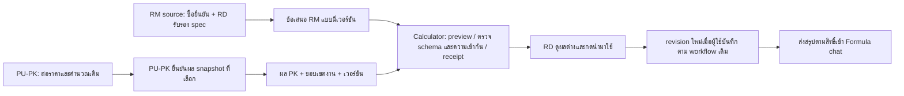

# เชื่อม RM และ PU-PK ให้ทำงานต่อเนื่อง

**อัปเดต 2026-09-08 หลังคำสั่งทำขั้น 1–4:** เจ้าของเลือกทิศทางดึงผ่านระบบแล้ว ข้อความรอเลือกช่องทางด้านล่างเป็นบันทึกรอบออกแบบเดิม ไม่ใช่คำถามที่ต้องถามซ้ำ งาน local รอบนี้เพิ่ม source reference/confirmation guard และ IN arithmetic preview ตาม TASK; ยังต้องกรอกผล PU-PK และวางข้อมูล IN จึงยังไม่ผ่าน acceptance เรื่องไม่กรอกซ้ำ ตัวเชื่อมตรงและ physical mapping ยังไม่เปิดใช้งาน ดู docs/PK_SOURCE_MAPPING.md และ UAT extension สำหรับขอบเขตที่ทำแล้ว/หลักฐานที่ยังขาด
วันที่ 2026-09-08 · สถานะ DECISION_REQUIRED (ช่องทางรับข้อมูล) / HUMAN_GATE (ติดตั้งจริง)
task_id: cost-calculator-implementation-2026-09-05 · source inspected: index.html ที่ 3358674 และ browser แบบ read-only
เอกสารนี้เป็น change design ที่ตรวจทานได้ ไม่ใช่การประกาศว่าเปิด integration หรืออนุมัติ source migration แล้ว

## เป้าหมายและสิ่งที่รักษาไว้

RD ค้น/เทียบ/เลือก RM ในสูตร ไม่ต้องคัดชื่อหรือราคาเอง; PU-PK ต่อราคาและเลือกผลที่ต้นทางครั้งเดียว calculator รับ snapshot ตามงานและแสดงสิ่งที่เปลี่ยนให้ RD ตัดสินใจ ไม่ให้ PK ที่ช้าหยุด Formula/RM

fs_cost ยังคง local-first; ไม่ sync สูตรขึ้น server ไม่สร้าง RM/PK master หรือกฎ MOQ/loss/markup ชุดที่สอง ไม่เปลี่ยนสิทธิ์ Sales/OPC/Finance/CEO และไม่เพิ่ม CEO approval ในระบบ

ความต่อเนื่องมี 3 เรื่อง: ข้อมูลไม่ต้องกรอกซ้ำ · ผู้ใช้เห็นสถานะ/ผู้รับผิดชอบ · เวอร์ชันไม่ใช้ผิดงาน การเชื่อม network เพียงอย่างเดียวไม่ปิดครบสามเรื่อง

## 1. ตรวจพบจริง

| แหล่ง | สิ่งที่มีแล้ว | ช่องว่างที่ต้องปิด |
|---|---|---|
| RM workbook ที่ผู้ใช้ยืนยัน | 26 tabs; master/map/formula/pricing/raw/parent/tier/review/log | ต้องกำหนด authoritative offers projection; README/03/09 ยังบอก workflow ใน Sheet ซ้อนกับ calculator |
| RM parent view | Parent ID, raw terms, source lineage, Eligible Tier Count | อย่าใช้ count/latest raw price แทนข้อเสนอซื้อหนึ่งเวอร์ชันที่ยืนยันแล้ว |
| Calculator RM import | direct price-header detection แล้ว fallback Data Center mapper | ผู้ใช้ไม่ควรต้องเดาว่า parser เลือกเส้นใด; preview ต้องบอก source sheet/route/coverage ก่อนนำเข้า |
| PU-PK workbook | 15 visible sheets; Incoming_ReqPK นำเข้าคำขอ; pricing history, dashboard, quote data, policy, monitor | ใช้ของเดิมก่อน ไม่สร้างคำขอ/ประวัติราคาซ้ำ |
| PU_Pricing_History | 59 columns และ Snapshot_ID; prior source review พบ revision lineage/selected totals | ยืนยัน mapping ฟิลด์และ semantics แบบ source-level ก่อนเขียนจริง; header ไม่พิสูจน์ immutability |
| PK_Response_Outbox | Response_ID, Req-PK No, Quote_ID, ToEmail, Subject, EmailBodyHTML, ApprovedToSend, SentAt | เป็น email outbox ไม่ใช่ calculator transport; ห้ามใช้ ApprovedToSend/SentAt เป็น commercial confirmation หรือ receipt ใน calculator |
| Calculator PK ปัจจุบัน | PU-PK กรอกยอด/expiry/evidence แล้วสร้าง local snapshot; RD กด adopt | กรอกซ้ำและไม่มี source acknowledgement; source snapshot/version ต้องถูกเก็บแยกจาก local sequence |
| ประวัติ source review PK | APPROVED เกิดตอน save; QuoteEffectiveCost รวมบาง surplus recovery | ห้ามแปลง APPROVED เป็น confirmed; ห้าม map effective cost เป็น consumed base หรือบวก surplus ซ้ำ |

Browser inspection อ่านชื่อหน้า/โครงสร้างและหัวคอลัมน์ ไม่รันเมนู Apps Script ไม่ส่งอีเมล ไม่ตรวจค่าการเงินจริง ไม่ export raw data. จำนวนแถว grid คือขนาดพื้นที่ Sheet ไม่ใช่จำนวน record ที่มีข้อมูล

## 2. เส้นทางที่เสนอ

“รับข้อมูลแล้ว” ต่างจาก “นำมาใช้แล้ว” และต่างจาก “ราคาพร้อมเสนอ” ทุกขั้นต้องมีสถานะแยก RM และ PK ล้มเหลวแยกกัน ไม่ block การเปิดสูตร

ช่องทางยังรอเจ้าของเลือก:
- **กดอัปเดตจากต้นทาง**: อ่าน snapshot ผ่าน endpoint ที่ยืนยันตัวตนและขอบเขตข้อมูล ไม่เปิด public sheet/API ไม่ฝัง secret ใน browser ไม่ sync fs_cost กลับไป ติดตั้งต้องผ่าน review/operator
- **ไฟล์มาตรฐาน**: source export snapshot พร้อม manifest ผู้ใช้ import แบบ preview เดียวกัน ลดการพิมพ์ซ้ำแต่ยังมีการส่งไฟล์ ไม่มีการอ้างว่าถอนราคาได้ทันทีเมื่อ offline

ไม่เริ่มสร้าง endpoint, auth หรือแก้ source production ก่อนปิดข้อนี้ คำถามถูกส่งใน conversation แล้ว ยังไม่มีคำตอบ ไม่ถือว่าความเงียบคือคำอนุมัติ

## 3. ปรับ RD Data Center

### 3.1 หน้าและงานที่ทำจริง

1. **00_README** แสดงทางเข้าสามบทบาท: RD ค้น/เทียบ, Procurement เติม/ยืนยัน, ผู้ดูแลแก้ mapping/quality ระบุชัดว่า Cost Calculation เป็นที่ทำสูตรและ revision หลัก
2. **01_Ingredients_Master** เป็นมุมมองค้นที่แสดง spec/ข้อเสนอ/ความพร้อม ข้อมูล stock และ DQ เป็นส่วนเสริม ไม่มีราคา Max มาแทน selected Tier
3. **02/08/raw/parent/tier** ใช้ดูแลและตรวจที่มา ไม่ให้ RD ต้องไล่เปิดเพื่อเลือกประจำวัน; raw ไม่ถูกเขียนทับ
4. **03/09** ตรวจการใช้งานจริงก่อนกำกับเป็น workflow เดิม/อ้างอิง ไม่มีการลบ tab หรือสูตรที่คนยังใช้; owner ของ confirmation ต้องมีแห่งเดียวต่อชนิดหลักฐาน
5. **คิวข้อมูลค้าง** รวบเหตุผลที่ยังส่งใช้ไม่ได้: identity/spec/terms/expiry/version scope/ambiguity พร้อม source row และผู้รับผิดชอบ ไม่สร้างคิวที่ให้กรอกข้อมูลเดิมซ้ำ

### 3.2 Offers projection ที่ต้องพิสูจน์ก่อนเชื่อม

ใช้ stable identity ปัจจุบันของแหล่ง ไม่สร้าง ID จากลำดับแถวหรือ fuzzy name; source parent ID ต้อง map กับ calculator material identity อย่างตรวจสอบได้ การเปลี่ยน identity ต้องมี explicit reviewed crosswalk และไม่แก้ snapshot เก่า

ข้อมูลขั้นต่ำ:
- source namespace, material/offer ID, offer version, source row เป็นหลักฐานประกอบ
- ชื่อ/ชื่อเรียก/spec ที่ source มีจริง; spec version + RD acceptance แยกจาก purchase confirmation
- vendor/Tier, currency, price + basis quantity/unit, MOQ/unit, increment/unit, upper bound ถ้ามี, LT, validFrom/validUntil ที่มีหลักฐาน
- scope กลาง/เฉพาะงานและข้อจำกัด, confirmed actor/time/version, withdrawal/currentness, source evidence/version
- source-as-of และ receipt/import time คนละค่า

ให้หนึ่ง row/object เป็นหนึ่งข้อเสนอและหนึ่ง Tier ไม่ส่ง slash list เข้าสูตร การ parse ใช้ canonical .gs เดิม ไม่ทำสูตร parse ใน Sheet ซ้ำ

Preview แสดง: workbook/แท็บ/route, จำนวนวัสดุ, จำนวนข้อเสนอ, พร้อมเลือก, รอข้อมูล, ตีกลับ, ข้อเสนอใหม่/เปลี่ยน/ถูกถอน และเวลา source ที่พิสูจน์ได้ ห้ามเรียก fetch time ว่าเวลาที่จัดซื้อยืนยัน

ถ้าได้รับเฉพาะบางแถวต้องประกาศ partial scope; ห้ามตีความ material ที่ไม่อยู่ในไฟล์ว่าโดนถอนทั้งหมด การ retire ใช้ semantics เดิมของ represented-material snapshot หรือ explicit tombstone ตาม contract ที่ตกลง

## 4. ปรับ PU-PK

### 4.1 ขั้นตอนของ PU-PK

Req-PK เดิม → หา/ต่อราคาได้หลายรอบ → สร้าง pricing snapshots ตามระบบเดิม → ตรวจผลรวมและ component ครบ → กด **ยืนยันผลนี้สำหรับงาน…** → เตรียมผลสำหรับ calculator

ปุ่มยืนยันเป็น action แยกจาก save และการส่ง email ต้องแสดงงาน จำนวน หน่วย ขนาดบรรจุ spec revision ยอดหลังบวก และ expiry ที่จะรับรองก่อนกด ถ้าไม่มีข้อมูลบังคับให้หยุดพร้อมเหตุผล ไม่ auto-confirm จาก label APPROVED

กรณี requirement ยังไม่ผูก Formula: อ้าง cost job ภายในและ request ID ให้คงที่ ใช้ mapping ตาม contract; ไม่ยัดชื่อ project ลงช่องอ้างอิงและถือว่า match แล้ว

### 4.2 ขอบเขต snapshot

- source Snapshot_ID + source RevisionNo/lineage; local receipt ID แยกออก ไม่เอา local count มาอ้างว่าเป็น source version
- Req-PK No, Source_Quote_ID, costJobId, Formula projectId nullable, scenario/requirement revision
- spec/pack size, sellingUnits/unitsPerPack, quantity/unit ที่ตกลงแล้ว, component membership และ coverage เพื่อไม่เอาราคากล่องอย่างเดียวเป็น PK ครบทั้งชุด
- explicit purchase confirmation actor/time/snapshot version และ RD spec acceptance ที่เกี่ยวข้อง
- adjusted lot total, currency, pricing basis/policy version และสิ่งที่รวมแล้ว
- consumed base = null ถ้ายังพิสูจน์ไม่ได้; purchase cash / surplus / recovered surplus / residual exposure เป็น measure แยก ไม่รวมเป็น base เพื่อให้ครบ
- validFrom/Until, superseded/withdrawn/currentness, source-as-of, export/receipt scope

Mapping ที่ห้ามเดา: SelectedSellingTotal เป็น candidate ของ adjusted lot เท่านั้นจนตรวจ CustomerQty/Unit และราคา scenario; SelectedRate ไม่แทน lot total; QuoteEffectiveCost ไม่ใช่ consumed base โดยอัตโนมัติ

### 4.3 การต่อราคาหรือเปลี่ยนผล

| เหตุการณ์ | ผลที่ควรเห็น |
|---|---|
| ได้ร่างใหม่ยังไม่ยืนยัน | แสดง candidate “รอยืนยัน” ตาม contract draft; ไม่ถือเป็นราคาพร้อมเสนอ |
| source v2 ยืนยันแทน v1 | แจ้ง “มีผลใหม่” พร้อม diff; เก็บ v1 ไว้และไม่ auto-adopt |
| จำนวน/spec เปลี่ยนระหว่างรอ | ส่ง requirement version ใหม่; ผลเก่ากลับมาขึ้น “ไม่ตรงโจทย์ปัจจุบัน” ไม่ทับ candidate ใหม่ |
| ถอน v1 | กันการนำไปใช้ใหม่/ใช้เป็นราคาพร้อมเสนอเมื่อรับหลักฐานถอนแล้ว; เอกสาร revision เดิมยังคงเดิม |
| source ส่งซ้ำหรือ reply มาผิดลำดับ | receipt idempotent; ไม่ append duplicate และไม่ถอย candidate เป็นเวอร์ชันเก่า |
| PK ยังไม่ครบ/ไม่มา | RM/formula ยัง save/compare/ส่งสรุปบางส่วนตามกฎเดิมได้ |

ยังไม่กำหนดอายุความสด N นาทีขึ้นเอง หาก offline หรือไม่มี currentness proof ให้แสดง “ตรวจต้นทางล่าสุดเมื่อ…” การรับประกันว่าใช้ได้ตอนเสนอราคาต้องมีเกณฑ์ source freshness ที่ owner ตัดสิน

## 5. Receipt และขอบเขตความปลอดภัย

เสนอ envelope ร่วมเฉพาะข้อมูลขนส่ง ไม่ใช่ master:
schemaVersion, sourceSystem, packetId, sourceVersion, producedAt, sourceAsOf, scope, completeness, payload, revokedReferences
Source identity/fingerprint มีไว้ correlation ไม่ใช่หลักฐาน authentication; JSON หรือ hash ที่ผู้ส่งเขียนเองปลอมได้

- ตรวจ shape/types/units/required evidence และ bounds ก่อนเก็บ
- ตรวจ account/capability/target job และ request sequence อีกครั้งหลัง async read
- preview read-only; commit receipt แบบ atomic; failed storage ต้องไม่แจ้งสำเร็จ
- แยก receipt จาก adopt; manual draft ห้ามหายเมื่อ refresh
- raw RM/PK ห้ามผ่าน shared chat; chat ใช้ safe projection ตามสิทธิ์เดิม
- online endpoint ต้อง enforce source-side access ไม่อ้างว่า UI permissions ใน localStorage ป้องกัน extraction
- file transport ให้ใช้ไฟล์ที่องค์กรอนุมัติเท่านั้น ยังมี local tamper limitation ตาม ADR; ไม่อ้างว่าเป็น authenticated confirmation เพียงเพราะ manifest บอกชื่อผู้ยืนยัน
- ไม่ใช้ email outbox ส่ง raw payload เพิ่ม และไม่เปิดเมนู send/email ระหว่างงานนี้

## 6. ลำดับงานที่ทำให้จบเป็นส่วน ๆ

| ID | Deliverable | สถานะ / เกณฑ์ปิด |
|---|---|---|
| C0 | ตรวจ surfaces RM/PK และเจ้าของกฎ | สำรวจ UI แล้ว; source-level physical mapping ยังไม่ครบ |
| C1 | เลือก direct-read หรือ versioned-file transport | DECISION_REQUIRED; ทั้งสองคง local-first formula |
| C2 | RM mapping/projection + import preview | หลังเลือกทางและมี sanitized source implementation/schema ใน worktree; ทดสอบ stable identity, ambiguity, stale/version/partial |
| C3 | PU-PK explicit selection confirmation + outbound snapshot | ต้องตรวจ source save/status/monetary semantics; รวม component/requirement linkage และ mapping reconciliation |
| C4 | calculator receipt/diff/adopt | ใช้ UI/core/store เดิม optional fields, capability3ชั้น, retry/storage/quantity tests และ mutation |
| C5 | UAT ระหว่าง RD/Procurement/PU-PK | ทดสอบ RM ready, pending PK, negotiation v1→v2, stale reply, expiry, source unavailable; จับเวลาคน |
| C6 | CODEOWNER review / approved source release / operator deploy | HUMAN_GATE; ไม่ทำใน design turn |

ไม่เริ่ม C2–C4 ด้วยตัวเลขสมมติธุรกิจ; synthetic tests ใช้พิสูจน์ code เท่านั้น ไม่ปิด live mapping ด้วย mock การปรับชีตที่มี script ใช้อยู่ต้องเห็น dependency/สูตรก่อนเพิ่มคอลัมน์ ไม่แทรกคอลัมน์กลางที่ parser อ้าง index

## 7. Acceptance เพื่อเรียกว่า “ต่อเนื่อง”

- RD เลือก RM และ PU-PK ยืนยันผลแล้วไม่ต้องพิมพ์ราคาใหม่ใน calculator
- ทุกยอดอธิบายได้ว่ามาจาก source/version/quantity/spec ใด
- source ready มีแต่ spec pending ต้องยังเลือกใช้เสนอไม่ได้
- หลาย component ไม่รวมซ้ำ ไม่ลืม component และไม่บวก markup/surplus ซ้ำ
- ดูผลใหม่โดยไม่เปลี่ยน revision เก่า; นำมาใช้ด้วย action ของผู้มีสิทธิ์
- pending/failure ของแหล่งหนึ่งไม่ปิดอีกหมวด; partial ไม่เรียกต้นทุนรวม
- ถ้าข้อมูลต่างเครื่อง/หมดอายุ/ตรวจ currentness ไม่ได้ต้องเห็นสถานะตรงจริง
- count imports/confirmation/receipt/adoption แยกกัน ไม่ใช้ email sent เป็น calculator success
- ผ่าน 4 suites ตาม project และ mutation ของกฎใหม่; UAT ≤30 วินาที/รายการและเทียบ manual; ไม่มี raw data leak

## ผลส่งมอบรอบนี้

status: DECISION_REQUIRED
files_changed: เอกสารนี้ และลิงก์แผนใน TASK.md
commits: ดู git log
tests_run: source/UI read-only review + git diff --check; ไม่มี app edit จึงไม่อ้างผล app suite ใหม่
security/permission/database/dependency impact: none
rollback: revert documentation commit
open_risks: transport decision, source implementation/mapping evidence, fresh-state/identity/monetary semantics, UAT และ release gate
issue_id/pr_reference: none

---

## 8. ตรวจหลักฐานตัวเชื่อมที่มีจริงใน worktree — 2026-09-09

ตรวจตามที่ได้รับมอบหมาย (งานถัดไปข้อ 5) ว่าใน worktree นี้มีหลักฐานอะไรที่ใช้เชื่อม Stock Inventory เข้ากับ calculator ได้จริง
และขาดอะไรอย่างเจาะจง **ไม่สร้าง mock เพิ่มเพื่อเรียกว่าเชื่อมเสร็จ**

### สิ่งที่มีจริง (ตรวจแล้ว)

| หลักฐาน | อยู่ที่ | ครอบคลุมแค่ไหน |
|---|---|---|
| หัวตารางแถว 1 ของ IN · IN Price Snapshot · Master Item · Movement · Stock onhand · Reserve | `REGISTRY.md` | ชื่อคอลัมน์และ metadata เท่านั้น ไม่ได้อ่านแถวธุรกิจหรือราคาจริง |
| ความหมายของ Price / Unit Cost / THB / ทศนิยม 2 ตำแหน่ง | `REGISTRY.md` + ข้อยืนยันเจ้าของ | ใช้ตรวจยอดรับเข้าได้ ยังไม่ผูกกับฐานราคาของ calculator |
| กฎ AVAILABLE-only และไม่หัก Reserve | ข้อยืนยันเจ้าของ 2026-09-08 | เป็นคำยืนยันเชิง workflow ยังไม่ได้ตรวจสูตร/โค้ดต้นทาง |
| ตรรกะแสดงผลและกฎรวมแถว | `docs/prototypes/rm-picker.js` + เทสต์ 11 module / 21 browser | ทำงานกับข้อมูลสังเคราะห์ในหน้าเท่านั้น |

### สิ่งที่ขาด — ต้องมีก่อนเรียกว่าเชื่อมจริงได้

| แกน | สถานะจริง | สิ่งที่ต้องได้มา และจากใคร |
|---|---|---|
| **authenticated read** | **ไม่มีเลย** — ค้นทั้ง `apps_script/*.gs` และ `index.html` ไม่พบตัวอ่าน Stock onhand สักตัว (`onhand` ไม่ปรากฏในโค้ด) หน้าทดลองใช้ข้อมูลในไฟล์ตัวเอง | เจ้าของระบบเลือกช่องทางก่อน (ข้อ 2 ของเอกสารนี้ยังเป็น DECISION_REQUIRED) · ต้องได้ workbook id + ชื่อแท็บ + ผู้ถือสิทธิ์อ่าน + วิธียืนยันตัวตนที่ไม่ฝัง secret ใน repo |
| **stable identity** | ยังไม่มีคีย์ถาวรของแถวคลัง — REGISTRY ระบุเองว่า IN ต้องมี stable line/event identity ก่อน import ซ้ำอย่างปลอดภัย และ RD/PU-PK ยังไม่ได้กำหนดรหัสคลัง | เจ้าของข้อมูลคลังกำหนดคีย์ต่อแถว (เช่น doc+line หรือ lot+location) ที่ไม่เปลี่ยนเมื่อจัดเรียงชีตใหม่ |
| **mapping item/spec/UOM** | ยังไม่มีตารางจับคู่จริงระหว่าง `materialId` ของ calculator กับ New Code/Old Code ของคลัง · หน้าทดลองใช้ `link.confirmed===true` เป็นสมมติฐาน ไม่มีที่มา | จัดซื้อ/RD ยืนยันคู่ item+spec+UOM ทีละรายการ · **ห้าม fuzzy-match** ตามข้อยืนยันข้อ 3 · ต้องระบุด้วยว่า UOM ของคลังกับของสูตรแปลงกันอย่างไร (ปัจจุบัน prototype สมมติ kg ทั้งหมด) |
| **AVAILABLE filtering ฝั่งต้นทาง** | กรองที่ฝั่งแสดงผลเท่านั้น · ยังไม่ยืนยันว่า `status` ในชีตมีค่าอะไรได้บ้าง และใครเป็นผู้เปลี่ยน | เจ้าของข้อมูลให้รายการค่า status ทั้งหมด + ความหมาย + ใครแก้ได้ · ถ้ากรองฝั่งต้นทางไม่ได้ ต้องบอกว่าหน้าจอกรองเองและอาจเห็นสถานะช้ากว่าจริง |
| **freshness** | ไม่มีเวลาอ่านล่าสุดของจริง · หน้าทดลองพิมพ์เวลาไว้ตายตัวในหน้า | ต้องมี timestamp ที่พิสูจน์ได้ต่อการอ่านหนึ่งครั้ง · เอกสารนี้ข้อ 5 กำหนดไว้แล้วว่าห้ามตั้งอายุความสดขึ้นเอง ถ้าไม่มี proof ให้แสดง "ตรวจต้นทางล่าสุดเมื่อ…" |
| **ฐานราคา** | ยังไม่ตัดสิน — ข้อยืนยันข้อ 5 ห้ามใช้ราคา IN ล่าสุดอัตโนมัติ และ Master Item `Cost per unit` ก็ไม่แทนข้อเสนอปัจจุบัน | เจ้าของระบบตัดสินว่าฐานราคาของ RM ที่เลือกจากคลังมาจากไหน (ข้อเสนอที่ยืนยันแล้วเท่านั้น หรือมีทางอื่น) ก่อนย้ายเข้า calculator จริง |

### ข้อสรุป

หลักฐานที่มีพอสำหรับ **ทวน workflow บนหน้าทดลอง** เท่านั้น ยังไม่พอสำหรับ integration ใด ๆ
ห้ามนับหน้าทดลองหรือเทสต์สังเคราะห์เป็นหลักฐานว่าเชื่อมต้นทางแล้ว
เมื่อย้ายเข้าแอปจริงต้องใช้ canonical domain เดิม (marker `COST_RM_SOURCE_DOMAIN` + `tools/sync-rm-browser-domain.js`)
ห้ามเก็บตรรกะของ prototype ไว้เป็น business rule ชุดที่สอง

status ของข้อนี้: **WAITING_FOR_INPUT** — ตัวบล็อกแรกคือช่องทางอ่านข้อมูล (ข้อ 2) ซึ่งยังเป็น DECISION_REQUIRED
