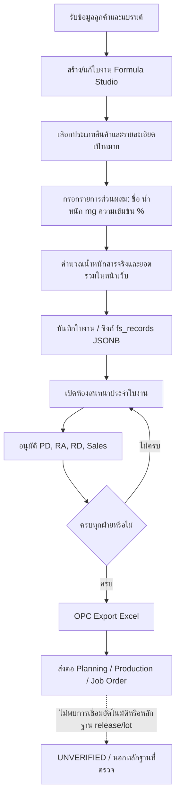
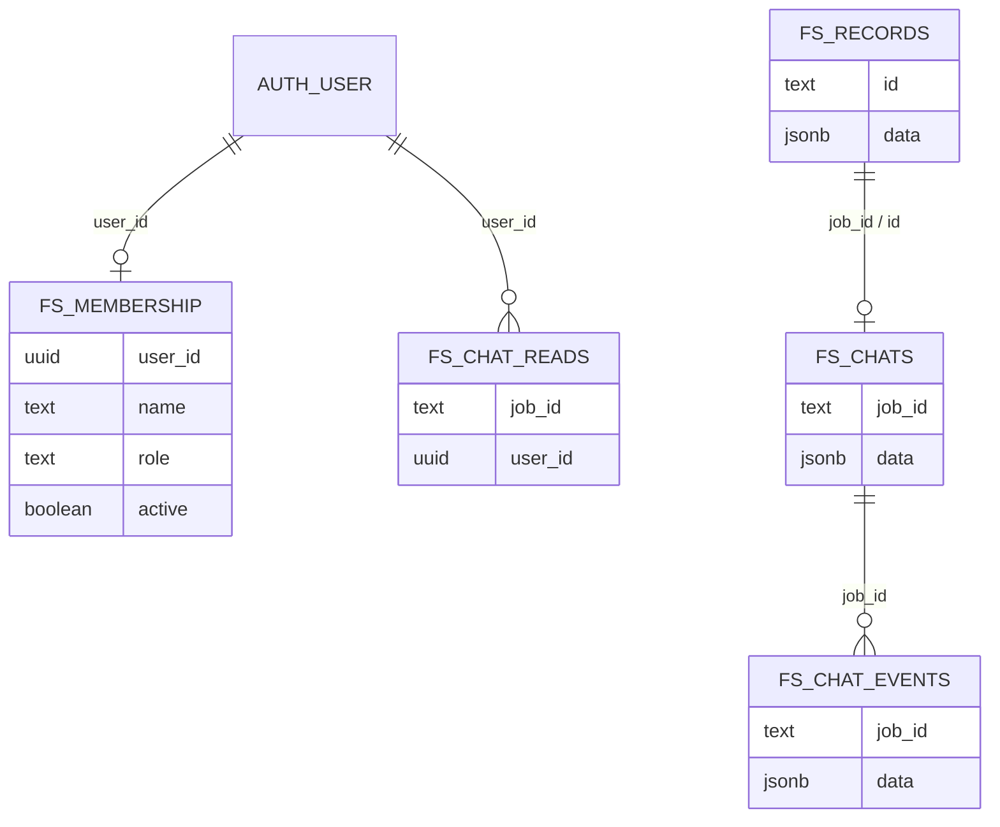
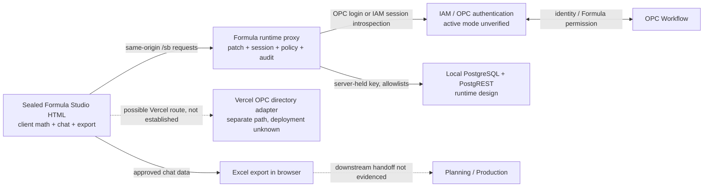

# Beyond Formula — Deep System Understanding & Formulation Workflow Audit

**วันที่ตรวจ:** 2026-10-27 (เวลาไทย)  
**สถานะ:** UNVERIFIED สำหรับ runtime ที่ใช้งานจริง; พบช่องว่างเชิงออกแบบที่ต้องตรวจยืนยันใน gateway โดยเฉพาะการอ่านข้อมูลแบบ scope `ALL`. ข้อกล่าวหาเดิมเรื่อง direct Supabase RLS และ OPC directory API ถูกลดระดับเป็นความเสี่ยงแบบมีเงื่อนไขหลังพบ runtime wrapper แยกต่างหาก  
**ประเภทงาน:** C0 Discovery / Read-only Audit  
**Task ID / Issue ID:** ไม่พบในคำสั่งหรือหลักฐานที่อ่านได้ จึงไม่กำหนดขึ้นเอง  
**ขอบเขต:** ตรวจ source, schema, tests, configuration templates และ Understand Anything graph ของ Beyond Formula; เพิ่มการอ่านเอกสาร/source แบบ read-only จาก `/Users/user/Desktop/formula-runtime-job-sync` และสรุป gateway audit log ที่มีอยู่แล้วโดยไม่แสดงตัวระบุผู้ใช้หรือ payload; ไม่อ่าน environment/secrets, ไม่เรียก endpoint, ไม่เชื่อมต่อฐานข้อมูล และไม่สร้าง/แก้ข้อมูลจริง

**ยืนยัน workflow เพิ่มเติม:** เปรียบเทียบเอกสาร architecture/registry/integration กับ runtime handoff และ post-live แล้ว สรุปขอบเขต workflow และข้อขัดแย้งระหว่างเอกสารไว้ใน [RECONCILE_2026-10-27.md](/Users/user/Developer/Beyond-formula/docs/RECONCILE_2026-10-27.md). ข้อสรุปหลัก: รับ brief → ใบงาน → คำนวณพื้นฐาน → chat review/approval → export มี implementation evidence; การรับเข้า OPC, BOM, production release และ lot traceability ยังไม่มีหลักฐานเพียงพอให้ยืนยันเป็น workflow ปัจจุบัน.

## วิธีอ่านสถานะหลักฐาน

- **VERIFIED** หมายถึงยืนยันจากไฟล์ source/schema/config/test ที่อ้างอิงได้ใน checkout นี้เท่านั้น
- **DOCUMENTED_REVERIFY** หมายถึงพบคำอธิบายใน source comment หรือ metadata ซึ่งควรยืนยันกับ runtime/เจ้าของระบบ
- **UNVERIFIED** หมายถึงไม่มีหลักฐานเพียงพอในขอบเขตที่ตรวจ หรือจำเป็นต้องดู runtime/ระบบภายนอก
- การมี source code ยืนยันได้เพียงว่ามี implementation อยู่ใน checkout ไม่ได้ยืนยันว่าเปิดใช้หรือทำงานในระบบจริง
- คำว่า “ไม่พบ” หมายถึงไม่พบในไฟล์ที่รวมอยู่ในการตรวจครั้งนี้ ไม่ใช่ข้อยืนยันว่าไม่มีอยู่ในเอกสารหรือระบบอื่น

## A. Executive Summary

เมื่ออ่านเอกสารสอง repository เทียบกัน ภาพที่แม่นยำกว่าคือมีอย่างน้อยสองชั้น: (1) repo Beyond Formula มีแอป HTML/JavaScript และเอกสาร local preview แบบ `launchd` บน loopback ที่ยังใช้ Supabase ได้; (2) repo `formula-runtime-job-sync` อธิบาย production wrapper ที่เสิร์ฟ HTML รุ่นผนึก, แทรก session/job-sync bridge, เปลี่ยน Supabase REST ไปผ่าน gateway และชี้ upstream ไป PostgreSQL/PostgREST ในเครื่อง. **สถาปัตยกรรมชั้นที่สองมีหลักฐานจากเอกสารและ source ของ runtime แต่ยังไม่ได้ยืนยันว่าเป็น process/release ที่ทำงานจริงขณะตรวจ.** `RUNTIME_OPERATIONS.md:25-37`; runtime `AGENTS.md`; `docs/FORMULA-RUNTIME-RULES.md:14-23`; `runtime/formula-proxy.mjs:43-68,192-228`.

หลักฐาน app source ยืนยันการกรอก/แก้ record, arithmetic น้ำหนัก × potency, chat approval 4 ฝ่าย และ Excel export. Runtime wrapper เพิ่มการตรวจสิทธิ์ server-side, compare-and-save สำหรับใบงาน, การตรวจ IAM/OPC และทางรับงานที่ทนการส่งซ้ำตาม source ที่อ่านได้. สิ่งเหล่านี้ช่วยควบคุมทางเข้า/การเขียนและการชนกันของการบันทึก แต่ **ไม่เท่ากับ immutable formula revision หรือการผูก revision กับ production lot**. ไม่พบ batch/serving conversion, overage, yield/loss หรือ BOM/costing implementation ในแอปที่ตรวจ; อย่างไรก็ดีพบโฟลเดอร์ `cost calculator by project/` ที่บันทึก workflow ต้นทุนและเสนอราคาซึ่งผู้ใช้เคยยืนยันไว้. โฟลเดอร์นั้นระบุเองว่าเป็น documentation handoff, untracked ใน parent repo, delivery tasks 0/27 complete และ historical audit FAIL; จึงเป็น **ข้อกำหนดที่บันทึกไว้ ไม่ใช่ความสามารถที่พร้อมใช้งาน**. `cost calculator by project/SPEC.md:3-39`; `TASK.md:3-8`; `docs/IMPLEMENTATION_PLAN.md:458-472`.

ข้อกล่าวหาเดิมที่ว่า RLS ของ Supabase เป็นช่องอ่าน production โดยตรง **ยังยืนยันไม่ได้และไม่ควรนำไปสรุปเช่นนั้น**: runtime rules ระบุว่าย้ายจาก Supabase ไป PostgreSQL ในเครื่องและ proxy บล็อกปลายทาง Supabase; `RUNTIME_OPERATIONS.md` เองอธิบาย local static deployment ที่เป็นคนละขอบเขต. อย่างไรก็ดี proxy GET ที่อ่านพบตรวจ `FORMULA_VIEW` ด้วย `record_scope: ALL` แล้วส่งต่อ query โดยไม่พบ row filter ตามเจ้าของ Sales ใน gateway excerpt. นี่เป็น **ช่องว่าง implementation ที่ต้องตรวจการให้สิทธิ์ IAM และ deployment จริง** ไม่ใช่หลักฐานว่า Sales ทุกคนเข้าถึงข้อมูลจริงได้. API OPC ของ Vercel ก็อาจอยู่นอกเส้นทาง runtime wrapper; การเปิดใช้จริง UNVERIFIED.

### สิ่งที่ยืนยันได้และข้อจำกัด

| หัวข้อ | สรุป | สถานะ |
|---|---|---|
| Project/Git | `/Users/user/Developer/Beyond-formula`, branch `codex/job-alerts-chat-save`, HEAD `a3f48592cf11cc31b870f35d1c58191e27364771` | VERIFIED |
| Working tree | มีการแก้ไขค้างอยู่ทั้งก่อนงานนี้ และมีไฟล์ใหม่จากงานอื่น; ไม่มีการแก้ไฟล์เหล่านั้นในการตรวจนี้ | VERIFIED |
| Knowledge Graph | `.ua/knowledge-graph.json`, 22 ไฟล์, 34 nodes, 19 edges, 5 layers, 9 tour steps; HEAD ใน metadata ตรงกับ HEAD ข้างต้น | VERIFIED สำหรับ artifact |
| Graph freshness | Graph วิเคราะห์ working tree ขณะนั้นด้วย จึงไม่ได้แทน HEAD ที่สะอาดหรือ commit ที่อนุมัติ; ความครอบคลุมมีเพียง 22 ไฟล์ | VERIFIED |
| Runtime / deployment | อ่านเอกสารและ source ของ runtime แยก; project connector ไม่ตรงกับ Supabase host ใน app repo; ไม่เรียก health/endpoint หรือ query ตาราง | สถาปัตยกรรมที่ระบุใน repo VERIFIED; process/config/release ที่กำลังทำงาน UNVERIFIED |
| Test result | ไม่รัน tests ตามขอบเขต read-only; มี test files และ CI workflow ใน source | VERIFIED (presence), ผลล่าสุด UNVERIFIED |

## B. Business Workflow Map



**ขอบเขตของแผนภาพ:** A–J มีหลักฐาน implementation ใน UI/JavaScript; F เป็น storage model ตาม schema และ sync code. ลูกศร K และการปล่อยสูตรเพื่อผลิตยังไม่มีหลักฐาน integration ในไฟล์ที่ตรวจ จึงไม่ควรตีความว่าระบบส่งข้อมูลถึง Planning/Production จริง.

- มีช่องกรอกลูกค้า, แบรนด์, Sales owner และเบอร์ติดต่อ; มี ID ภายในรูปแบบ `A00001…` จากตัวจัดสรรรหัสใบงาน. ไม่พบฟิลด์/การอ้างอิง OPC Job ID ใน code/schema ที่รวมไว้. `index.html:769-787`, `index.html:2528-2555`, `index.html:3914-3927`.
- แก้ใบงานเดิมโดยอัปเดต object เดิมและคง ID/createdAt/createdBy ไว้; ไม่ใช่การสร้าง formula revision snapshot. `index.html:2528-2545`.
- ห้องสนทนาผูกกับ job ID; approvals มี PD, RA, RD, Sales. การเปลี่ยนสูตรในห้องสนทนาล้าง approvals ที่มีและบันทึก system message. `index.html:4632-4638`, `index.html:4768-4772`, `index.html:5275-5310`.
- Export ต้องมีสิทธิ์ `export` และครบ approvals; implementation ระบุ Admin/OPC ใน role configuration และ code gate. `index.html:2778-2795`, `index.html:5474-5484`.
- **UNVERIFIED:** ว่า Excel ที่ส่งออกเป็น BOM ที่ถูกนำเข้า Planning/Production, ผ่าน QA/approval แยกต่างหาก, ถูกล็อกเป็นสูตรที่อนุมัติ หรือถูกผูกกับ manufacturing lot จริง.

### หลักฐานการใช้งานจริงจาก gateway log (อ่านอย่างเดียว)

ตรวจ `~/.hermes/apps/formula-studio/monitoring/gateway-2026-10-26.ndjson` โดยกรองเฉพาะ `stack=formula` ตามข้อกำหนด runtime และดูคู่วัน 2026-10-26/27; ไฟล์ของวันที่ 27 ยังไม่มี. พบ 1,738 บรรทัด JSON ที่อ่านได้, ไม่มีบรรทัดเสียหรือไม่มีค่า stack. log ครอบคลุมเวลา UTC 01:23–12:06 ของวันที่ 26 ต.ค. (08:23–19:06 เวลาไทย). **นี่เป็นหลักฐานกิจกรรมที่ gateway บันทึกในวันนั้น ไม่ใช่การรับรอง release/runtime ที่ทำงานอยู่วันนี้.**

| เหตุการณ์ที่บันทึก | จำนวน | การตีความที่อนุญาต |
|---|---:|---|
| signed-in | 27 | จำนวนเหตุการณ์เข้าใช้ ไม่ใช่จำนวนผู้ใช้ไม่ซ้ำ |
| job-received ที่ status=saved | 4 | gateway บันทึกการรับ/บันทึกงานสำเร็จ 4 เหตุการณ์; ไม่เปิด ID หรือ payload |
| job-save-blocked | 1 | มีเหตุการณ์บล็อกการบันทึกหนึ่งครั้ง; สาเหตุ/ผู้ใช้ไม่ถูกรายงาน |
| ID sequence RPC ที่ status HTTP 200 | 43 | มีการขอเลข 43 ครั้ง; ไม่เท่ากับใบงานที่บันทึกจริง |
| fs_chats writes | 18 events / 18 rows | มีการบันทึกข้อมูลห้องสนทนา |
| fs_messages writes | 19 events / 21 rows | มีการบันทึกข้อความหลายแถว; ไม่อ่านเนื้อหาข้อความ |
| fs_activities writes | 46 events / 271 rows | มีการบันทึก activity หลายแถว |
| upstream write / write-failed | 126 / 0 | gateway บันทึก write ที่ upstream ตอบสำเร็จ 126 เหตุการณ์ และไม่พบ write-failed ใน log วันดังกล่าว |
| denied / client-blocked | 238 / 88 | มีเหตุการณ์ปฏิเสธ/บล็อกตาม label; ไม่สรุปว่าเป็นความผิดพลาดหรือการโจมตี เพราะไม่ได้เปิดอ่านเหตุผล/IP/ตัวตน |

ยังยืนยัน approval ที่ครบทุกฝ่ายไม่ได้: พบ label `approval-change` 2 ครั้ง แต่ label นี้ไม่พบใน runtime source checkout ที่ตรวจ; log ไม่มี release/build identifier ให้จับคู่กับ HEAD. จึงไม่ใช้สองเหตุการณ์นั้นเป็นหลักฐานว่า Formula approval หรือ CEO quotation approval ผ่าน. `runtime/formula-proxy.mjs:347-394,553-556,1385-1421,1545-1558`.

**ขอบเขต log:** runtime docs ระบุ log นี้เก็บในเครื่องที่ `~/.hermes/.../monitoring/`, ไม่พบการผูก log provider บนเว็บใน repo ที่ตรวจ; จึงใช้ log ในเครื่องที่มีอยู่ ไม่ query Supabase/Cloudflare/Vercel logs ที่ไม่ตรงกับ runtime path. ไม่เปิดชื่อ/อีเมล/IP/เลขงาน/เหตุผล/เนื้อหาสูตร และไม่เรียก service endpoint.

## C. Formula Data Architecture



ER diagram นี้แสดงเฉพาะ entity/ความสัมพันธ์ที่ยืนยันได้จาก `supabase/schema.sql`; `rows` ส่วนผสมและ field อื่นเก็บอยู่ใน JSONB ไม่ใช่ตาราง ingredient/BOM/cost/revision ที่แยกกัน.

พบเอกสารออกแบบ Cost Calculator แยกต่างหากที่ระบุ scenario/revision, RM/PK/Operation, source/rate versions และ CEO quote snapshot แต่ไม่มี entity/code ที่ทำให้โมเดลนี้ทำงานในแอปที่ตรวจ; สถานะของงานออกแบบและข้อจำกัดอยู่ใน [เอกสารยืนยัน workflow](/Users/user/Developer/Beyond-formula/docs/WORKFLOW_CONFIRMATION_2026-10-27.md).

| Module | หน้าที่ / input → output | หลักฐานและ dependencies | ผลกระทบเมื่อต้องเปลี่ยน | สถานะ |
|---|---|---|---|---|
| Formula UI / record | เก็บข้อมูลลูกค้า/ผลิตภัณฑ์/ส่วนผสม → object ใบงาน | `index.html:769-835`, `index.html:2481-2555`; vanilla HTML/JS | รูปแบบ JSONB, import/export, guards, UI editors และ sync | VERIFIED |
| Ingredient reference | แนะนำค่าความเข้มข้น/ต้นกำเนิดจาก `IDB` ในตัวแอป | `index.html:2143-2165` เป็นต้นไป; ไม่เห็น call ไป Raw Material Master | สูตรเดิมและค่าที่กรอกอาจไม่ผูกกับ material master/รหัส/lot | VERIFIED (local reference) |
| Calculation | `w`, `p` → `actual = w*p/100`; รวม `w` และ `actual` เป็น mg | `index.html:2399-2429`, `index.html:5295-5310` | FDA display, formula rows, saved `actual`, exported workbook | VERIFIED |
| Approval / chat | role-based approvals, messages, events และ read state | `index.html:4632-4638`, `index.html:4768-4772`, `index.html:5440-5462`; SQL chat RPC/guards | Export gate, approval validity, audit evidence | VERIFIED (implementation) |
| Persistence / sync | `fs_records(id,data jsonb)`, chats/users/activities/meta/memberships และ chat events/reads; RLS | `supabase/schema.sql:7-62`, `:350-379`, `:645-686`; `index.html:6236-6243` | JSON shape, SQL triggers/policies, offline sync and restore | VERIFIED (source) |
| OPC directory | API ตรวจ token กับ Auth provider แล้วเรียก upstream directory; UI match ด้วย email | `api/opc-user-directory.js:9-61`, `index.html:6378-6440` | Account lookup privacy, availability, identity matching | VERIFIED (implementation); runtime UNVERIFIED |
| BOM / cost / production lot | ไม่พบ entity หรือ code path เฉพาะในชุด source/schema ที่ scan | schema และ application files ใน graph | ต้องออกแบบ ownership/integration ก่อน handoff ที่ตรวจสอบย้อนหลังได้ | UNVERIFIED |

## D. Calculation Logic Review

### Logic ที่พบ

- หน้าสูตรคำนวณ `actual = weight × potency / 100`; แสดงผลเป็น `mg` โดยคงทศนิยม 2 ตำแหน่งบน UI. ผลรวมคำนวณ `totW += w` และ `totA += w*p/100`, แสดงเป็น mg. `index.html:2399-2429`.
- เมื่อแก้ช่องน้ำหนักหรือความเข้มข้นในแชท โค้ดใช้ `parseFloat(value)||0`, คำนวณใหม่ และบันทึกค่า `actual`. `index.html:5295-5310`.
- มี dropdown หน่วยในฟอร์มผลิตภัณฑ์และข้อมูล serving/package size แต่ไม่พบการแปลงหน่วยที่นำมาใช้ใน calculation path นี้; ช่องน้ำหนักส่วนผสมใช้ mg ตาม UI. `index.html:849-860`, `index.html:963-979` (fields), `index.html:2399-2429`.

### ความเสี่ยง/ขอบเขตที่ยังพิสูจน์ไม่ได้

1. **หน่วยและมิติ:** ไม่พบ conversion ระหว่าง g/mg/µg/IU/ml ในฟังก์ชันคำนวณที่ตรวจ; การรับค่าต่างหน่วยโดยไม่มี conversion/validation อาจทำให้ปริมาณผิด แต่ข้อผิดพลาดจริงใน runtime ยัง UNVERIFIED.
2. **ความหมายของ potency:** formula เป็นน้ำหนัก × เปอร์เซ็นต์; ไม่พบหลักฐานว่ารองรับ potency basis หลายชนิด, active ingredient ต่อ serving หรือค่าที่มีหน่วยเฉพาะ.
3. **ตัวเลขขอบเขต:** `parseFloat(...)||0` ทำให้ค่าที่ว่าง/อ่านไม่ได้กลายเป็นศูนย์ในจุดที่เห็น; จาก excerpt นี้ยังไม่สรุปว่าทุก input ยอมรับค่าลบ/เกินขอบเขต เพราะต้องตรวจ validation ทั้งฟอร์ม.
4. **Rounding:** UI ปัดเพื่อแสดง 2 ตำแหน่ง แต่ยังไม่พบข้อกำหนด precision สำหรับค่าที่เก็บ, export หรือรวม batch; ความเท่ากันของผลรวมที่แสดงกับข้อมูลผลิตจริง UNVERIFIED.
5. **ไม่มีหลักฐาน:** batch scaling, serving size calculation, overage, process loss/yield, batch total reconciliation หรือ release-time validation ใน source ที่สแกน.
6. **การประเมินตามกฎหมาย:** มีข้อมูล/reference สำหรับ FDA check แบบฝังใน client (`index.html:1193+`, `:2143+`); รายงานนี้ไม่ยืนยันความถูกต้องหรือความเป็นปัจจุบันของเกณฑ์ตามกฎหมาย.

**ข้อสรุป:** ยืนยันได้เพียง arithmetic path แบบ mg และ potency %. ยังไม่ควรใช้หลักฐานนี้ยืนยันการคำนวณสูตรผลิตจริงหรือความแม่นยำทางกฎหมาย.

## E. Formula Revision, Approval & Traceability

| คำถาม | คำตอบจากหลักฐาน |
|---|---|
| แก้สูตรที่อนุมัติแล้วได้ไหม? | UI อนุญาตให้ PD/Admin แก้สูตร; code path แก้ object ใบงานเดิม. เมื่อผ่าน `chatSaveFormula` จะล้าง approvals ใน chat ถ้ามีและเพิ่ม system event/message. `index.html:2778-2785`, `:4768-4772`, `:5275-5310`. VERIFIED (implementation). การเรียก path อื่นให้ผลเดียวกันทุกกรณี UNVERIFIED. |
| การแก้มีผลต่อสูตรเดิมที่เคยผลิตหรือไม่? | ไม่มี version snapshot หรือ production-lot relation ที่พบ; การอัปเดต object เดิมบ่งชี้ว่า record ปัจจุบันเปลี่ยน. ผลต่อ records ในระบบจริง/การผลิตเก่า UNVERIFIED. |
| แยก Draft/Approved/Released อย่างไร? | พบ chat approval 4 ฝ่ายและ export gate; ไม่พบสถานะ formula lifecycle Draft/Review/Approved/Released หรือ release entity ใน schema/source ที่รวมไว้. VERIFIED ว่า approval chat มีอยู่; lifecycle states UNVERIFIED/ไม่พบ. |
| ตรวจย้อนหลังว่าใครแก้อะไรได้ไหม? | มี chat system message และ `fs_activities`/`fs_chat_events` event storage; edit path เขียนข้อความการเปลี่ยนแปลง. แต่ยังไม่มีหลักฐาน formula revision snapshot ที่รับประกันครบถ้วนและ immutability. VERIFIED (event mechanisms); complete audit history UNVERIFIED. |
| ยืนยันสูตรต่อ production lot ได้ไหม? | ไม่พบ entity/key เชื่อมสูตร/version กับ production lot. UNVERIFIED/ไม่พบในชุดตรวจ. |
| ป้องกันการเลือก revision ผิดอย่างไร? | ไม่มีหลักฐาน revision identifier/release lock ในสูตร. Export gate ตรวจเพียง approvals ของ chat ปัจจุบันตาม job. VERIFIED (gate logic); production enforcement UNVERIFIED. |

**ประเมิน:** approvals ถูกผูกกับห้องสนทนา/ใบงาน ไม่เห็นว่าผูกกับ cryptographic/versioned snapshot ของ formula rows. การ invalidate approvals เมื่อแก้ผ่าน chat เป็น safeguard ฝั่ง application แต่ไม่ใช่ immutable release control.

## F. IAM & OPC Integration Status

### Current implementation เทียบกับ target

| หัวข้อ | Current code evidence | เทียบ Target / สถานะ |
|---|---|---|
| Login/session | App repo มี Supabase Auth path (`index.html:6246,6276-6313`); runtime proxy source รองรับ OPC-verified signed session, optional Cloudflare Access, และ optional IAM carrier session ที่ introspect กับ IAM ทุกคำขอ (`formula-proxy.mjs:1615-1655,1744-1834,1944-1955`). | มี implementation หลาย mode; active mode ใน runtime config ยัง UNVERIFIED. `fs_auth_session` เป็นของ app code path; IAM mode ใช้ `fs_iam_session`. |
| Formula identity/role | Runtime fallback mode จับ OPC `accessEmail`/email กับ `fs_users`; IAM mode รับ `central_user_id` + `legacy_user_id`, แล้วจับ legacy ID กับ Formula profile (`:1661-1675,802-822,890-903`). | มี identity bridge ใน source; การเปิดใช้งานจริงและค่าคู่ mapping ใน IAM UNVERIFIED. |
| OPC integration | Runtime มี OPC login delegation (`formula-proxy.mjs:1615-1655`) และ gated provisioning route; IAM session login มี `audience: FORMULA` (`:1796-1833`). App repo ยังมี OPC directory lookup path (`index.html:6378-6440`). | Runtime login/provisioning source มีจริง; directory adapter เป็นอีกเส้นทางที่อาจใช้กับ Vercel ไม่ใช่หลักฐานว่า runtime wrapper เรียกมัน. |
| API identity gate | Runtime wrapper มี route allowlist, session check และ IAM permission check ก่อนส่ง `/sb/rest/v1` ต่อ (`formula-proxy.mjs:1250-1326`). App repo API adapter ตรวจ Auth token แต่ไม่ตรวจ Formula membership/role (`api/opc-user-directory.js:16-60`). | Adapter concern เป็น **conditional** หาก Vercel/API route ถูกเปิดใช้; active public route UNVERIFIED. |
| ID mapping | IAM mode เชื่อม `central_user_id` กับ `legacy_user_id` ซึ่งต้องตรงกับ `fs_users.name` (`formula-proxy.mjs:802-822,890-903`); OPC fallback ใช้ accessEmail/email lookup. | ไม่มีหลักฐาน crosswalk ถาวรสาม ID ที่รวม IAM ID, OPC user ID และ Formula ID; email/profile mapping เป็น implementation bridge แต่ ownership/lifecycle ยัง UNVERIFIED. |
| Role enforcement | Runtime source ตรวจ `FORMULA_VIEW` สำหรับ GET/HEAD และตรวจ role/permission สำหรับ writes (`:973-1021,1309-1371`). IAM mode map `FORMULA_ADMIN` และ `FORMULA_RD` (`:798-812`). | ด่าน server-side มีใน source. Permission query ระบุ `record_scope: ALL` (`:713-720`) และ gateway ไม่เห็น row-owner filtering ก่อน forward GET. IAM-session map ใน source มีเพียง Admin/RD; coverage ของ RA/Sales/OPC/MKT/Purchasing ในโหมดนี้ยังไม่เห็น. ทั้งการจำกัด Sales read และ role coverage จึงต้องตรวจ grant/config จริง. |
| Legacy/local auth | Bare app มี localStorage fallback (`index.html:3183-3207`); runtime successful gateway patch ทำให้ app เข้า sync mode ผ่าน same-origin `/sb`, และ wrapper เป็นผู้ตรวจ session (`formula-proxy.mjs:200-223,1271-1285`). | fallback ยังมีใน app repo แต่ไม่ควรใช้กับ runtime ที่ patch สำเร็จ; active deployment/mode UNVERIFIED. |
| Logout/session expiration | App session lifecycle มีใน source; IAM runtime mode introspects และขอ revoke session ตอน logout (`formula-proxy.mjs:1749-1777`). | Implementation evidence; IAM live behavior, session expiry และ revocation ยัง UNVERIFIED. |
| iMac PostgreSQL / IAM session | Runtime source ตั้ง upstream data gateway แบบ fail-closed หากชี้ไป Supabase (`formula-proxy.mjs:43-68,1250-1257`); IAM direct-session mode มีให้เปิดด้วย config (`:95-104,1744-1834`). | target architecture มี implementation บางส่วน; ค่า `stack.env`/`runtime/data.env` ไม่ได้อ่าน และไม่ยืนยัน config/runtime จริง. |

### Conditional finding: read scope ของแอปและ gateway อาจกว้างกว่าการกรองใน UI

- `visibleRecords()`/`canSeeRecord()` จำกัด Sales ไว้ที่ `createdBy===currentUser` ใน client (`index.html:3962-3968`).
- Bare app schema ให้ select ตาม active membership (`supabase/schema.sql:359-365,657-679`), แต่ runtime docs/code ระบุว่า browser ถูก patch ให้ใช้ same-origin gateway และ Supabase ถูกบล็อก (`runtime/formula-proxy.mjs:200-228,1250-1257`). ดังนั้น direct Supabase finding นี้ **ไม่ใช่หลักฐานช่องทาง production ปัจจุบัน**.
- สิ่งที่ยังต้องตรวจคือ runtime gateway อนุญาต GET/HEAD หลัง IAM `FORMULA_VIEW` โดยกำหนด `record_scope: ALL` และส่ง query ต่อ (`runtime/formula-proxy.mjs:713-720,1309-1325,1528-1533`); ไม่พบตัวกรองเจ้าของ Sales ในทางนี้. เป็น **HIGH if deployed config grants broad FORMULA_VIEW to Sales; currently UNVERIFIED**. ไม่ได้ query ข้อมูลหรือทดสอบ session.

### Conditional finding: Vercel OPC directory adapter ไม่ตรวจ Formula membership/role

- Handler ตรวจ token ด้วย Auth user endpoint แล้วส่ง `payload.users` ทั้งชุดกลับ (`api/opc-user-directory.js:28-60`); ไม่มี lookup membership หรือ role.
- API route ป้องกันด้วย authentication แต่ source ที่เห็นไม่ได้จำกัด audience ตาม authorization. อย่างไรก็ดี runtime proxy route map ที่ตรวจไม่แสดง `/api/opc-user-directory` และมี default 404 สำหรับ path อื่น (`runtime/formula-proxy.mjs:2187-2205`); API adapter น่าจะเป็นเส้นทาง Vercel/แอปเปล่า. ดังนั้น exposure เป็น **conditional on Vercel deployment/config; UNVERIFIED**, ไม่ใช่ finding ที่ยืนยันกับ runtime wrapper.

### IAM Gates G1/G2/G3

| Gate | สถานะ | หลักฐานที่ขาด |
|---|---|---|
| G1 — identity/session integration | PARTIAL implementation / runtime UNVERIFIED | source มี OPC login delegation และ IAM session flow; ต้องยืนยัน mode ที่เปิด, iMac identity authority, issuer/audience/session expiry ใน runtime |
| G2 — mapping & role boundary | PARTIAL implementation / runtime UNVERIFIED | มี `central_user_id` + legacy Formula profile และ Formula-specific roles; ยังขาดหลักฐาน persistent IAM↔OPC↔Formula mapping lifecycle และ per-record read-scope enforcement |
| G3 — rollout/operational readiness | UNVERIFIED | approved deployment evidence, user migration/provisioning plan, monitoring/recovery, UAT และ acceptance โดย System Owner |

## G. Architecture, Data Flow & Reliability



- **Frontend:** single large `index.html` (7,262 lines observed) with HTML/CSS/JS, UI state, role capability checks, formula math, chat and export. VERIFIED.
- **Backend:** app repo contains client Supabase REST/Auth and a Vercel directory API. A separate runtime repo implements a Node HTTP reverse proxy, session bridge, IAM/role gate, local PostgreSQL/PostgREST gateway, audit logs and job-integrity flow. `formula-proxy.mjs:1250-1603,2124-2226`; source presence VERIFIED.
- **Database:** runtime documentation/source states local PostgreSQL/PostgREST is the selected data plane and Supabase is blocked; app repo still contains Supabase schema/config. Actual deployed DB remains UNVERIFIED because live environment and DB were not inspected. Runtime docs describe DB grants as `anon` plus proxy authorization as the identity-aware boundary (`FORMULA-RUNTIME-RULES.md:99-126`).
- **Runtime/build:** app repo documents a local `launchd` static preview at loopback; runtime repo documents a Docker Blue/Green wrapper. Treat these as distinct environments unless the owner confirms otherwise. Runtime checkout branch `codex/job-integrity-repair`, HEAD `a6a0c4a826d6b20e0e0a6de92195a02da50421a2`; sealed metadata at `releases/CURRENT` points to build `2026-09-23.1`, commit `b01e68d...`. That metadata does not prove what is currently running. `RUNTIME_OPERATIONS.md:27-51`; `FORMULA-RUNTIME-RULES.md:130-156`.
- **Vercel route:** wrapper source handles `/sb/session`, `/sb/rest/v1/*`, known assets and otherwise returns 404 (`formula-proxy.mjs:2178-2205`); the Vercel OPC adapter may be a separate deployment path. Reachability is UNVERIFIED.
- **Error handling:** client auth/session and sync error handling exists; API returns generic 401/503 and no-store headers. Source existence only; no live failure behavior tested. `api/opc-user-directory.js:3-7,21-64`.
- **Logging/audit:** `fs_activities`, `fs_chat_events`, chat messages and SQL trigger guards exist. These mechanisms do not by themselves prove tamper-proof or complete formula history. `supabase/schema.sql:18-35,36-62,149-228`.
- **Tests:** `tests/formula-studio.test.js` has 80 `test(...)` declarations by static count; OPC adapter suite has 3. Existing `index.html` UI formula edit path has at least a test named to invalidate chat approvals, but no direct calculation/unit/scaling test was found in searched test corpus. Test presence is VERIFIED; outcomes are not known because tests were not run.
- **Runtime tests:** มี test files สำหรับ IAM/session, job sync, gateway policy และ recovery ใน runtime repository แต่ไม่รันตามข้อห้ามใน `formula-runtime-job-sync/AGENTS.md` และ `FORMULA-RUNTIME-RULES.md:18-23`: ไม่มี test stack แยก และการทดลองบน write endpoint อาจเขียนข้อมูล production. รายงานนี้จึงนับเพียงการมีไฟล์ ไม่กล่าวว่า tests ผ่าน.
- **CI:** workflow invokes `node harness.js` and `./tests/run-sql-tests.sh` on PRs to main. CI outcome for current dirty tree/HEAD is UNVERIFIED; this audit did not run it.

## H. RD Business Gap & Risk Analysis

| มิติ | Current capability | Missing / unverified | Business impact | Technical dependency | Risk | Evidence / recommendation |
|---|---|---|---|---|---|---|
| 1. Formula workflow completeness | ใบงานลูกค้า/ผลิตภัณฑ์, ingredients, chat, four-party approvals, Excel export | lifecycle ตั้งแต่ request → controlled release → production handoff/lot ไม่ยืนยัน | งานอาจต้องคัดลอกซ้ำและไม่มีจุดควบคุมก่อนผลิต | workflow owner, production contract, released formula identity | HIGH | `index.html:769-835,4632-4638,5474-5484`; define state transition and handoff contract |
| 2. Calculation accuracy | amount × potency %, mg totals | unit conversion, serving/batch, loss/yield, overage, rounding contract และ validation ไม่พบ | ปริมาณสาร/ยอดรวมอาจไม่ตรงหน่วยหรือ batch intent | RD-approved calculation specification and material units | HIGH | `index.html:2399-2429`; specify dimensional rules, precision, bounds, then test independently |
| 3. Raw material data integrity | static client-side ingredient reference and free-text row fields | authoritative raw material code, supplier/spec/lot/version not evidenced | ingredient identity/potency/source drift; substitutions hard to trace | Raw Material Master source/owner and data contract | HIGH | `index.html:2143-2165`; agree master ownership and immutable material references |
| 4. BOM integration readiness | Excel export after approval | BOM revision/code mapping/standard batch/planning import/job order link not found | manual transfer error and no confirmed acceptance | OPC/Planning/Production interface and BOM ownership | HIGH | `index.html:5474+`; map target interface and reconciliation before release |
| 5. Costing reliability | app source มีเพียง product `price` field; แยกต่างหากมีเอกสาร Cost Calculator ระบุ RM/PK/Operation DL+OH, Procurement confirmation และ CEO quote approval | ไม่มี costing implementation ใน app ที่ตรวจ; design folder ยัง untracked, 0/27 delivery tasks complete, RM audit FAIL, PK source semantics blocked, policy/rates บางส่วน pending | ห้ามใช้เอกสารออกแบบหรือ synthetic trial อ้างว่าได้ต้นทุน/ราคาขายจริงหรือพร้อมเสนอ | ปิด audit findings, ยืนยัน sources/versions, pricing/rate/loss rules, access controls และ independent UAT | HIGH | `index.html:2501`; `cost calculator by project/SPEC.md:13-39`; `TASK.md:3-8`; `docs/IMPLEMENTATION_PLAN.md:433-472`; trial tests synthetic only |
| 6. Formula version control | current record update; chat approvals invalidate on chat formula edit | immutable revisions, diff/restore, release lock and production snapshot absent in inspected model | historical reproducibility and re-use uncertain | revision model, approval identity, storage migration/backward compatibility | HIGH | `index.html:2533-2545,5275-5310`; model versioned snapshot prior to production integration |
| 7. RD user experience | formula rows edit in chat; role labels and approval state | usability/validation in production not observed; no UAT evidence | rework and hidden manual steps remain unknown | RD/PD user observation and UAT | MEDIUM | implementation evidence only; observe real workflow using masked data |
| 8. Data traceability | job record ID, updatedBy, chat events/activity | immutable formula revision ↔ user/approval ↔ production lot chain not proven | investigation/recall cannot be evidenced from inspected model | stable identifiers and event provenance | HIGH | JSONB current state plus logs; define canonical trace chain |
| 9. Security & permission | Bare app has Supabase auth/RLS; runtime source adds session + IAM proxy checks | Runtime GET/HEAD uses FORMULA_VIEW scope ALL; Sales row filter not found in gateway. IAM role coverage/config and separate Vercel API reachability unknown | data scope may exceed Sales UI filter if those IAM grants/deployment paths are active | runtime auth mode, IAM grant matrix, and an isolated test stack (none currently documented) | HIGH if applicable; runtime UNVERIFIED | `formula-proxy.mjs:713-720,1309-1325`, app `:3962-3968`; don't infer production exposure from standalone Supabase schema |
| 10. Production handoff readiness | role-gated export after approvals | no confirmed BOM/revision/released formula/lot link or runtime handoff evidence | production may depend on manual interpretation/copying | OPC/production owner, interface contract, release and rollback controls | HIGH | no handoff entity found; require end-to-end acceptance evidence |

## I. Top 5 Development Priorities

ลำดับนี้เป็นข้อเสนอจากความเสี่ยง/ความพร้อมของหลักฐาน ไม่ใช่การอนุมัติให้เริ่ม implementation.

1. **ยืนยันขอบเขตสิทธิ์อ่านของ runtime** — ใช้หลักฐาน read-only/masked ตรวจว่า mode ใดเปิดอยู่และ IAM `FORMULA_VIEW` scope ถูกให้แก่ role ใด; เทียบกับ Sales own-only ที่ UI. ตรวจ Vercel adapter แยกต่างหาก. ยังไม่สรุป exposure จาก schema ฝั่งแอปเพียงอย่างเดียว.
2. **กำหนด immutable Formula Revision + approval binding** — ทุก revision ต้องมี version ID, reason, actor/time, snapshot และ approval ที่อ้าง snapshot เดียว; production release ต้องล็อก revision. เป็นฐานของ traceability และการเปรียบเทียบย้อนหลัง.
3. **ตกลงกฎคำนวณกับ RD ก่อนขยาย logic** — ระบุฐานหน่วย, serving/batch, scaling, overage, loss/yield, precision/rounding, total checks และ material potency semantics; ห้ามอนุมานกฎธุรกิจจาก UI.
4. **ปิดหลักฐาน Cost Calculator ก่อน implement** — ใช้ ownership ที่บันทึกไว้ (RD, Procurement, PU-PK, Finance, CEO) แต่ตรวจและแก้ historical audit FAIL, ยืนยัน source/version/status semantics, rate/loss/pricing inputs และ role-filtered disclosure ก่อนคำนวณจริง.
5. **ออกแบบ production handoff/BOM contract** — เชื่อม Formula Revision ที่ released กับ BOM revision, standard batch, OPC job/order และ production lot; เพิ่ม reconciliation/acknowledgement และ rollback/control evidence.

## J. Recommended Next 3 Actions

### 1) Security owner ยืนยัน deployed authorization ด้วยหลักฐานอ่านอย่างเดียว

- **Objective:** ระบุ runtime auth mode และว่า role ใดมี `FORMULA_VIEW`/scope กว้าง โดยไม่แก้ข้อมูล.
- **Scope:** ให้ Runtime/System Owner ส่ง sanitized health/config facts และ IAM permission matrix โดยไม่เปิดเผย secret หรือ record payload; ยืนยันว่า Vercel directory route อยู่ในเส้นทางที่ใช้จริงหรือไม่. ห้าม probe write endpoint หรือทำ login test ด้วยบัญชี Production.
- **Dependencies:** System Owner, Runtime Operator และ IAM owner; หากต้องทดสอบ authorization behavior ต้องสร้าง/อนุมัติ isolated environment ใหม่ก่อน เพราะ runtime rules ระบุว่าไม่มี test stack.
- **Expected outcome:** ข้อสรุปที่แยก implementation, active configuration และ effective permissions ได้.
- **Acceptance criteria:** มีหลักฐานระบุ release/mode, roles-permission mapping, read scope และ API route exposure; ไม่มีข้อมูลจริง/secret ใน output; independent Security review.
- **Required approval:** System Owner/Security owner ก่อนอ่านข้อมูลที่ระบุตัวบุคคล/สูตร หรือก่อนทดสอบใด ๆ ที่ส่งคำขอไป production.

### 2) RD/PD ทำ calculation specification และชุดตัวอย่างที่อนุมัติ

- **Objective:** ระบุกฎคำนวณสูตรและหน่วยอย่างชัดเจนก่อนปรับ code.
- **Scope:** นิยาม per serving / batch, หน่วยและ conversion, potency basis, rounding precision, overage/loss/yield, total validation, negative/empty/out-of-range behavior และ product-form exceptions.
- **Dependencies:** RD/PD process owner, representative synthetic examples, regulatory reviewer เมื่อกฎเกี่ยวข้องกับข้อกำหนด.
- **Expected outcome:** เอกสาร requirement ที่เป็น source สำหรับ implementation และ tests.
- **Acceptance criteria:** RD/PD ลงนามตัวอย่างคำนวณหลักและขอบเขต; แต่ละ product form ที่รองรับมี logic/ข้อจำกัดระบุ; expected outputs คำนวณซ้ำได้.
- **Required approval:** RD/PD business owner; Regulatory approval สำหรับกฎที่ตีความข้อกำหนด.

### 3) เจ้าของ OPC/Production ระบุ handoff contract และ trace chain

- **Objective:** ยืนยันว่าไฟล์ Excel ปัจจุบันเป็น handoff ที่ใช้จริงหรือเป็นเพียง export และกำหนดทางเชื่อมสูตรที่อนุมัติกับ BOM/Job/Lot.
- **Scope:** ระบุ system of record ของ raw materials, BOM, costs, OPC job/order และ production lot; field mapping, revision/release gate, acknowledgement/reconciliation และ exception handling.
- **Dependencies:** OPC workflow owner, Planning/Production owner, Raw Material Master owner, System Owner.
- **Expected outcome:** interface/process map ที่กำหนดผู้รับผิดชอบและข้อมูลที่ใช้ผลิตจริง.
- **Acceptance criteria:** มี approved field-level contract, owner ต่อข้อมูล, ตัวอย่าง synthetic end-to-end และหลักฐานการยืนยัน formula revision ที่ lot ใช้.
- **Required approval:** เจ้าของ OPC, Planning/Production, RD และ System Owner ก่อนเริ่ม integration.

## K. Test Coverage & Reliability

- มี 80 test declarations ใน `tests/formula-studio.test.js` และ 3 ใน `tests/opc-user-directory-adapter.test.cjs` (นับจาก source ปัจจุบัน). มี harness และ SQL test runner ใน CI.
- มีหลักฐาน test intent เกี่ยวกับ chat approval invalidation เมื่อสูตรแก้ไขใน `tests/formula-studio.test.js` (test case อยู่ราวบรรทัด 1108); ไม่มีหลักฐานผลผ่านในงานนี้.
- ไม่พบ dedicated tests ในการค้นแบบเจาะจงสำหรับ `calcRow`/`updateTotals`, unit conversion, scaling, serving/batch, rounding, overage/yield, cost calculation, immutable version preservation หรือ formula↔lot linkage.
- OPC adapter tests ครอบคลุมพื้นฐาน response/auth/config ตามชื่อและเนื้อหา test files; coverage ของ membership/role authorization ไม่มีหลักฐานใน handler/test ที่ตรวจ.
- CI workflow มี browser harness และ PostgreSQL RLS tests (`.github/workflows/verify.yml:14-41`). งานนี้ไม่ได้รัน tests; test result = **NOT RUN**.

**Test cases ที่ควรเพิ่มในอนาคต (ยังไม่ได้สร้าง):**

1. แปลง mg/g/µg/IU/ml โดยตรวจ dimensional compatibility และความแม่นยำ.
2. สูตรที่มี potency ต่ำ/สูง, ค่าขอบเขต, ว่าง, ลบ, decimal มาก และผลรวมตรง tolerance.
3. คำนวณ serving→batch หลายขนาด พร้อม overage/loss/yield และ rounding ที่กำหนดโดย RD.
4. แก้ revision หลัง approval แล้วตรวจว่า approvals ถูกผูก/invalidated กับ revision ที่ถูกต้องและ revision เก่าคงเดิม.
5. Sales อ่านได้เฉพาะงานตนเองผ่าน direct DB API; non-member และ role จำกัดถูกปฏิเสธทั้ง records/chats/events.
6. OPC directory ปฏิเสธผู้ไม่มี active membership/role และคืนเฉพาะข้อมูลตาม least privilege.
7. Export/production handoff ใช้เฉพาะ released revision; ตรวจ BOM/job/lot identity และ audit chain.

## L. Evidence Appendix

### Repository & graph

- Root: `/Users/user/Developer/Beyond-formula` (Git top-level ตรงกัน).
- Branch: `codex/job-alerts-chat-save`.
- HEAD: `a3f48592cf11cc31b870f35d1c58191e27364771`.
- Worktree ณ จุดตรวจมี dirty/untracked files จากงานก่อนหน้า/งานอื่น รวมถึง `AGENTS.md`, `docs/DEBUG_LOG.md`, `index.html`, `tests/formula-studio.test.js`, `.ua/`, `_IT-handoff/`, `cost calculator by project/` และเอกสารหลายไฟล์. ไม่ได้อ่าน/แก้ excluded sensitive folders หรือเอกสารเดิม และไม่ได้แก้ไฟล์ dirty เหล่านี้.
- Graph: `.ua/knowledge-graph.json`; metadata `.ua/meta.json` ระบุ hash เดียวกับ HEAD, `analyzedFiles: 22`, timestamp `2026-10-26T22:39:48.447Z`. Graph มี 34 nodes/19 edges, 5 architecture layers, 9 tour steps; validation รายงาน 0 critical, 0 dangling reference, 10 isolated-node warnings ตามผล Understand Anything.
- **ความทันสมัย:** hash เท่ากับ HEAD แต่ graph เก็บการวิเคราะห์จาก working tree ที่มีการแก้ไขค้างอยู่ด้วย จึงไม่ใช่ snapshot ของ HEAD เพียว ๆ. 22 files เป็นส่วนย่อยของ repository; `.understandignore` และ scan scope ตัด secrets, dependencies/build outputs, customer/costing/handoff material, docs และข้อมูล binary ออก. อ่าน/ตรวจ ignore rules ก่อนการวิเคราะห์; ไม่อ่าน `.env`.
- **Exclusions ที่ใช้กับ Understand Anything scan:** `.env*`, `**/.env*`, `node_modules/`, `**/node_modules/`, `.git/`, `**/.git/`, `dist/`, `**/dist/`, `build/`, `**/build/`, `cost calculator by project/`, `_IT-handoff/`, `docs/`, `**/*.zip`, `**/*.png`, `**/*.csv`, `**/*.xls`, `**/*.xlsx`, `**/*.jsonl`, `**/backup/**`, `**/backups/**`, `**/exports/**`, `print_test.html`, `TEST_PATCH_MARKER.txt`; scan รอบ audit เพิ่มการตัด Markdown และ `.ua/` ออกจาก scan input. รอบตรวจ workflow ภายหลัง อ่านเฉพาะเอกสารออกแบบที่ไม่ใช่ payload ใน `cost calculator by project/` ตามที่ผู้ใช้สั่ง; ยังคงไม่อ่าน `_IT-handoff/`, `local-only/`, secrets, business rows หรือไฟล์ raw.
- **Understand Anything skills:** catalog ที่ติดตั้งมี `understand-domain`, `understand-dashboard`, `understand-chat` และ `understand-explain`; audit นี้ใช้ graph ที่มีอยู่และตรวจ source ที่จำเป็น ไม่ได้เปิด dashboard/chat หรือเรียกคำสั่งย่อยเหล่านั้น เพราะไม่จำเป็นต่อการยืนยัน code/schema findings และ runtime access ไม่อยู่ในขอบเขต.
- **Read-only runtime discovery:** พบ repo `/Users/user/Desktop/formula-runtime-job-sync`, branch `codex/job-integrity-repair`, HEAD `a6a0c4a826d6b20e0e0a6de92195a02da50421a2`; อ่าน `AGENTS.md`, `docs/FORMULA-RUNTIME-RULES.md`, core proxy source, sealed release metadata และสรุปเฉพาะ aggregate ของ gateway log วันที่ 2026-10-26. ไม่อ่าน `runtime/stack.env`, `runtime/data.env`, log payload/ตัวระบุส่วนบุคคลหรือข้อมูลสูตรจริง; ไม่รัน tests/scripts และไม่เรียก endpoint/DB. ไฟล์ log วันที่ 2026-10-27 ไม่มีในขณะตรวจ.
- **ข้อจำกัด graph:** Understand Anything graph ครอบคลุมเฉพาะ Beyond Formula repo 22 ไฟล์ ไม่ได้รวม runtime repo; runtime architecture ใน addendum มาจากการอ่านเอกสาร/source แยก ไม่ได้มาจาก graph.
- **Cost Calculator folder:** อ่านเฉพาะ `AGENTS.md`, `SPEC.md`, `REGISTRY.md`, `TASK.md`, `CONTEXT.md`, implementation plan และ synthetic workflow-trial report; ไม่อ่าน `local-only/`, raw source data หรือ business rows. พบว่า design ระบุการแบ่งหน้าที่/quotation workflow ชัด แต่ folder ยัง untracked ใน parent tree และ delivery status 0/27; ไม่ถือเป็น app implementation หรือ approved GitHub baseline.
- **Supabase connector check:** มี project ที่เชื่อมต่อได้สองรายการ แต่ไม่มี reference ตรงกับ host ใน app source. จึงไม่ query project ใด. นี่ไม่ลบล้างหลักฐาน runtime source ที่ชี้ local PostgreSQL; เพียงยืนยันว่า live database/config ยังตรวจไม่ได้.

### Source references

| ประเด็น | Path / function | Lines |
|---|---|---|
| Product/customer inputs | `index.html` form sections | 769-835 |
| Product forms | `index.html` `f_form` options | 814-830 |
| Embedded ingredient reference | `index.html` `IDB` | 2143-2165+ |
| Ingredient arithmetic and totals | `index.html` `calcRow`, `updateTotals` | 2399-2429 |
| In-place record edit | `index.html` record builder | 2528-2555 |
| Role capability matrix | `index.html` `ROLES` | 2774-2807 |
| Sales UI-only ownership filter | `index.html` `visibleRecords`, `canSeeRecord` | 3962-3968 |
| Approval state | `index.html` `CHAT_PARTS`, `isFullyApproved` | 4632-4638, 4044-4048 |
| Approval invalidation | `index.html` `invalidateChatApprovals` | 4768-4772 |
| Formula edits and log | `index.html` `chatSaveFormula`, `chatIngEdit` | 5275-5310 |
| Export gate | `index.html` `exportChatExcel` | 5474-5484 |
| Auth session key/lifecycle | `index.html` `AUTH_SESSION_KEY`, `authStoreSession`, `authClearSession` | 6246, 6276-6313 |
| OPC adapter | `api/opc-user-directory.js` handler | 9-66 |
| OPC linking/matching | `index.html` `fetchOpcUserReference`, `matchOpcUserReference`, `authFetchMembership` | 6378-6474 |
| DB entity model / RLS | `supabase/schema.sql` | 7-62, 350-379, 645-686 |
| CI checks | `.github/workflows/verify.yml` | 1-41 |
| Hosting config | `vercel.json` | 1-12 |
| Test suites | `tests/formula-studio.test.js`, `tests/opc-user-directory-adapter.test.cjs` | 80 and 3 declarations respectively |
| Local preview documentation | `RUNTIME_OPERATIONS.md` | 25-51, 74-99 |
| Runtime authority/scope | `formula-runtime-job-sync/AGENTS.md`, `docs/FORMULA-RUNTIME-RULES.md` | AGENTS scope; rules 14-23, 54-126, 130-156, 211-258 |
| Runtime rewrite/session modes | `formula-runtime-job-sync/runtime/formula-proxy.mjs` | 43-104, 192-228, 794-823, 1250-1326, 1615-1834, 2178-2205 |
| Runtime compare-and-save | `/Users/user/Desktop/formula-runtime-job-sync/runtime/job-sync.sql`, `runtime/assets/fs-job-sync.js` | SQL function and injected client save path; tests not run |
| Runtime release metadata | `formula-runtime-job-sync/releases/CURRENT`, `releases/bd55f3c7077c/meta.json` | sealed metadata build `2026-09-23.1` |

### Change and verification record

```yaml
status: UNVERIFIED — runtime current state not accessed; source-level concern remains for broad FORMULA_VIEW read scope
task_id: not provided
issue_id: not provided
 files_changed:
   - docs/AUDIT_2026-10-27.md (new audit report)
   - docs/RECONCILE_2026-10-27.md (cross-repository workflow reconciliation)
   - docs/WORKFLOW_CONFIRMATION_2026-10-27.md (workflow and costing design evidence)
   - .ua/knowledge-graph.json and related .ua artifacts (Understand Anything analysis only)
 tests_run: none
 test_result: NOT RUN — read-only audit scope
 security_impact: no security settings changed; conditional gateway read-scope and Vercel directory authorization concerns documented
 database_impact: none; no database connection or mutation
 permission_impact: none changed; runtime and bare-app authorization paths distinguished; live grants unknown
 dependency_impact: none
 rollback: no application/runtime rollback required; remove the new report and/or generated .ua artifacts if the owner requests cleanup
 open_risks:
   - runtime GET/HEAD appears to authorize FORMULA_VIEW scope ALL without an owner-row filter; deployed IAM grants unknown
   - Vercel OPC directory route may be reachable independently; deployed reachability unknown
   - formula calculation/revision/BOM/production-lot behavior not evidenced by scanned application source; costing has a separate design but no verified implementation
   - local-only authentication fallback exists in source; active environment unknown
 pr_reference: none
```

## Critical Risks

1. **HIGH if deployed grants allow it; currently UNVERIFIED —** runtime gateway checks `FORMULA_VIEW` with `record_scope: ALL` and shows no per-record Sales owner filter before forwarding GET. Verify IAM grants and active runtime path before asserting exposure.
2. **CONDITIONAL / UNVERIFIED —** Vercel OPC directory handler lacks a Formula membership/role check; the separate runtime wrapper does not appear to expose that route. Confirm whether Vercel path is deployed and used.
3. **HIGH business-control gap —** No immutable formula revision or formula-to-production-lot traceability was found; runtime CAS protects concurrent saves but does not provide version history or lot linkage.
4. **HIGH business-control gap —** Calculation evidence covers only mg × potency %; unit conversion, batch/serving scaling, rounding contract, overage and process loss/yield are not established.
5. **UNVERIFIED —** active runtime process/release, auth mode, IAM permissions, database configuration, production handoff, and current CI/test outcomes were not accessed.
6. **HIGH business-control gap —** มี Cost Calculator workflow ที่ระบุเจ้าของและการอนุมัติ quote ไว้ในเอกสาร แต่ delivery ยัง 0/27, historical RM audit ยัง FAIL, PU-PK semantics/adapter ถูกระบุว่า blocked และ pricing/rate/loss inputs บางส่วนยัง pending. ห้ามใช้เอกสารหรือ synthetic trial เป็นหลักฐานต้นทุน/ราคาจริง.

## Recommended Next 3 Actions

1. ให้ System Owner/Security owner ยืนยัน runtime auth mode และ IAM `FORMULA_VIEW` grants แบบ read-only/masked ก่อนสรุป scope; ตรวจว่า Sales ผ่าน gateway แล้วอ่านได้เฉพาะข้อมูลที่ตั้งใจ โดยไม่ใช้ข้อมูลจริงเกินจำเป็น.
2. ให้ RD/PD อนุมัติ calculation specification และ synthetic reference cases ก่อนเปลี่ยนสูตรคำนวณ.
3. ให้ Cost Calculator owner ปิด audit/source/version/rate/access blockers ตาม plan ก่อน implementation; แยกงานนี้จากการออกแบบ production handoff ซึ่งอยู่นอก costing scope ที่ระบุใน SPEC.

**การเปลี่ยนแปลงที่ทำ:** เพิ่มรายงานนี้และสร้าง/อัปเดตเฉพาะ artifacts ของ Understand Anything ใน `.ua/`.  
**สิ่งที่ไม่เปลี่ยน:** application source, สูตรหรือ master data, schema/ฐานข้อมูล, authentication/IAM, runtime/deployment, dependencies, Git commit/push.  
**หลักฐาน:** Git identity/status, source line references, schema policies, test files/CI config และ graph metadata ตามภาคผนวก.  
**การตัดสินใจที่ยังต้องใช้ผู้รับผิดชอบ:** Security/System Owner ต้องยืนยัน IAM grants และสิทธิ์อ่านของ runtime; RD/Procurement/PU-PK/Finance/CEO ต้องรับรอง input และ commercial gates ตามขอบเขตของตนก่อนระบบ Cost Calculator นำไปใช้จริง. Codex สังเคราะห์ workflow จากหลักฐานได้ แต่ไม่สร้างสิทธิ์หรืออนุมัติข้อมูลต้นทุนแทน role เหล่านั้น.
