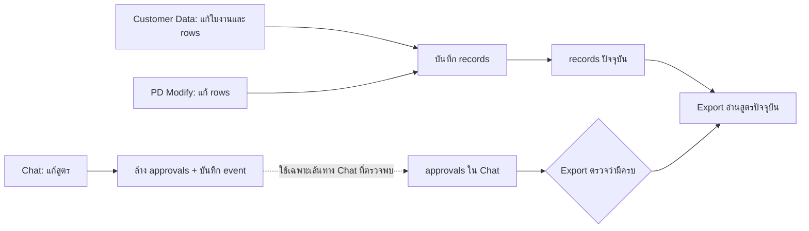

# Beyond Formula — ประเมินความเสี่ยงจาก Knowledge Graph

**วันที่:** 2026-10-27 (เวลาไทย)  
**สถานะ:** FAIL — พบช่องทางแก้สูตรที่อาจคงสถานะอนุมัติเดิมไว้  
**ประเภท:** ตรวจ source แบบอ่านอย่างเดียว; ไม่ทดสอบระบบจริงและไม่แก้ application code  
**ขอบเขต:** โหนด/เส้นเชื่อมของฟังก์ชันใน `index.html` และ `supabase/schema.sql`; ตรวจเส้นทางแก้ใบงาน สูตร อนุมัติ และส่งออกที่เกี่ยวข้อง

## สรุป

กราฟช่วยชี้ให้เห็นว่าข้อมูลสูตรถูกแก้ได้หลายทาง แต่การล้างการอนุมัติถูกรวมไว้เฉพาะบางทาง เมื่อแก้สูตรจากหน้า Customer Data หรือ PD Modify Data สถานะอนุมัติในห้องแชตอาจยังครบอยู่ ขณะที่ Export อ่านสูตรล่าสุดจากใบงานและตรวจเพียงว่ามีการอนุมัติครบหรือไม่ จึงมีความเสี่ยงส่งออกสูตรที่ไม่ได้รับอนุมัติฉบับปัจจุบัน

ข้อสรุปนี้ยืนยันจาก source ใน checkout ปัจจุบันเท่านั้น ยังไม่ได้ยืนยันว่า source เดียวกันอยู่ใน release/runtime ที่ใช้งานจริง

## ข้อค้นพบ

### HIGH — แก้สูตรบางเส้นทางได้โดยไม่ล้างการอนุมัติ

**หลักฐาน**

- `index.html:4231-4286` โหลดใบงานเดิม รวม `rows` ของสูตร กลับเข้าแบบฟอร์มแก้ไข
- `index.html:2470,2533-2545,2561-2568` อนุญาตผู้มี `createData` แก้ไขใบงานเดิม รวม `rows` แล้วบันทึก; ไม่พบการเรียก `invalidateChatApprovals` หรือบันทึกเหตุการณ์ `job_edit` ในเส้นทางนี้
- `index.html:3827-3862` PD Modify Data เปลี่ยน/เพิ่ม/ลบส่วนผสมแล้วเขียนกลับใบงาน; ไม่พบการล้าง approval หรือบันทึก chat event ใน `syncModifyRows` / `applyIngToRecord`
- `index.html:5275-5292` และ `index.html:5295-5310` เส้นแก้สูตรผ่าน Chat ล้าง approval ก่อนบันทึก แสดงว่าระบบตั้งใจให้สูตรที่แก้ต้องขออนุมัติใหม่
- `supabase/schema.sql:543-545` server ล้าง approval เมื่อได้รับ system event ประเภท `formula_change` หรือ `job_edit`
- `index.html:5474-5484,5507-5512` Export ตรวจว่ามี approval ครบ แต่ไม่ได้ตรวจ revision/hash ของสูตรที่อนุมัติ แล้วส่งออก `r.rows` ปัจจุบัน
- `tests/formula-studio.test.js:1108-1117` มี regression test สำหรับเส้นแก้ผ่าน Chat แต่ไม่พบ test เทียบเส้นแก้ผ่าน Customer Data หรือ PD Modify

**ผลกระทบที่เป็นไปได้**

หากมี approval ครบแล้วมีคนแก้สูตรผ่านเส้นทางที่ไม่ล้าง approval, Admin/OPC ยังอาจส่งออกข้อมูลสูตรใหม่โดยใช้สถานะอนุมัติเก่าได้ ความเสี่ยงนี้เกี่ยวกับความถูกต้องของการตัดสินใจและการส่งต่อสูตร ไม่ใช่หลักฐานว่ามีการส่งออกผิดจริง

**แนวทางแก้**

1. รวมการเปลี่ยนสูตร/ข้อมูลใบงานที่มีผลต่อการอนุมัติไว้ในจุดกลางเดียว ซึ่งบันทึกผู้แก้ เวลา และการเปลี่ยนแปลง พร้อมล้าง approval ในทุกเส้นทาง
2. ให้ approval อ้างอิง revision หรือ hash ของข้อมูลที่อนุมัติ; Export ต้องยืนยันว่า revision ปัจจุบันตรงกับ revision ที่ทุกฝ่ายอนุมัติ
3. ให้กติกานี้ทำงานทั้ง local mode และ secure/server mode ผ่าน event หรือ RPC ที่ตรวจสิทธิ์ฝั่ง server; อย่าพึ่งเฉพาะการซ่อนปุ่มหรือแก้สถานะใน browser
4. เพิ่ม focused checks สำหรับแก้จาก Customer Data, PD Modify และ Chat; ยืนยันว่าทุกเส้นทางล้าง approval เก่าและกัน Export จนกว่าจะอนุมัติ revision ใหม่

**การตัดสินใจจากเจ้าของกระบวนการ:** ระบุว่าการแก้ field ใดต้องขอ approval ใหม่ทั้งหมด ข้อแนะนำระหว่างรอคำตัดสินคือใช้กฎเดียวกับ `saveJobSection` ปัจจุบันซึ่งล้าง approval เมื่อแก้ส่วนของใบงาน และกำหนดข้อยกเว้นเฉพาะ field ที่ไม่กระทบสูตร/ข้อกำกับอย่างชัดเจน

### MEDIUM — กราฟยังไม่ใช่ภาพครบของ working tree

Dashboard แจ้งว่ามีไฟล์ใน working tree 224 รายการที่ไม่ตรงกับ commit metadata ของกราฟ ส่วน `project.gitCommitHash` ยังคงเป็น `a3f48592cf11cc31b870f35d1c58191e27364771`. โหนดฟังก์ชันที่เพิ่มใช้ source ปัจจุบันของ `index.html` และ `supabase/schema.sql` แต่โครงสร้างส่วนอื่นยังอิงกราฟเดิม จึงไม่ควรใช้กราฟนี้สรุปผลกระทบของการเปลี่ยนแปลงทั้ง repository จนกว่าจะ refresh ด้วยขอบเขตที่อนุมัติและคงข้อยกเว้นข้อมูลลับเดิม

**แนวทางแก้:** ใช้กราฟนี้นำทางระหว่างฟังก์ชันในสองไฟล์ที่ระบุ; ก่อนตัดสินใจเรื่องผลกระทบข้าม repository ให้ทำ Understand scan ใหม่โดยยืนยันรายการที่รวม/ละเว้น และตรวจให้ `analyzedAt`, commit และแหล่งข้อมูลตรงกับขอบเขตที่ต้องการ

### OBSERVATION — เส้น `calls` ใช้สำหรับหาเบาะแส ไม่ใช่ call graph ที่พิสูจน์ครบ

กราฟแสดงฟังก์ชัน 668 จุดและเส้น `calls` 1,057 เส้นใน source ที่ตรวจ แต่บางเส้นสร้างจากการจับคู่ชื่อ identifier/property access แบบที่ระบุปลายทางได้ ไม่ใช่การยืนยัน symbol binding ของ JavaScript ทุกกรณี เส้นเหล่านี้จึงช่วยหาจุดที่ควรเปิดอ่าน แต่ไม่ควรใช้เป็นหลักฐานเดี่ยวว่าฟังก์ชันหนึ่งเรียกอีกฟังก์ชันโดยตรง

**แนวทางแก้:** ใช้ source และ call-site จริงตรวจทานก่อนแก้; หากต้องการใช้กราฟทำ impact analysis อย่างเป็นทางการ ให้พัฒนาการเก็บตำแหน่ง call-site และการ resolve ชื่อให้แม่นขึ้น แล้วตรวจความถูกต้องกับกรณีทดสอบ

### MEDIUM — หลายหน้าที่รวมอยู่ใน JavaScript ไฟล์เดียว

โหนดแอป 653 จุดอยู่ใน inline script เดียวใน `index.html` และแบ่งกลุ่มตามหน้าที่ด้วยชั้นในกราฟเท่านั้น ยังไม่มีขอบเขตโมดูลจริงระหว่างสูตร ใบงาน แชต และ sync การแก้ฟังก์ชันที่เกี่ยวข้องกับหลาย flow จึงมีโอกาสกระทบส่วนอื่น และต้องอาศัยการไล่เส้นเชื่อม/ทดสอบผลข้างเคียงทุกครั้ง

**แนวทางแก้:** คงข้อจำกัด single-file ปัจจุบันไว้ แต่รักษากลุ่มฟังก์ชันและ entry point ให้ชัด, รวมการเขียนข้อมูลสำคัญไว้ใน helper ที่กำหนดสัญญาเดียวกัน, และเพิ่ม focused checks ตามกลุ่มธุรกิจ/เส้นทางข้ามกลุ่ม ก่อนตัดสินใจแยกไฟล์หรือเปลี่ยนสัญญา ให้ผ่าน workflow อนุมัติที่ project กำหนด

## ภาพเส้นทางปัญหาหลัก

## หลักฐานที่ยังขาด

- ไม่ได้รัน tests หรือจำลอง workflow ใน browser/ระบบจริงตามขอบเขตการตรวจนี้
- ไม่ได้ยืนยันว่า release/runtime ที่ใช้อยู่ตรงกับ source ใน checkout นี้
- ไม่ได้ตรวจฐานข้อมูลจริง, approval records จริง หรือไฟล์ export จริง
- ผลตรวจ graph schema ก่อนหน้านี้ยืนยันได้เพียงว่าโครงสร้างกราฟไม่มี node/edge ที่เสีย ไม่ได้ยืนยันความถูกต้องเชิงธุรกิจของทุกความสัมพันธ์
