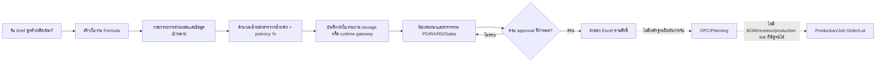

# เทียบเอกสารและยืนยันขอบเขต Workflow ของ Beyond Formula

วันที่ตรวจ: 2026-10-27 (เวลาไทย)  
สถานะ: **PARTIAL — ยืนยัน workflow ใน Formula Studio จาก source ได้; ยังยืนยัน workflow ข้ามไป OPC/Planning/Production และสถานะ runtime ปัจจุบันไม่ได้**  
ขอบเขต: อ่านเอกสารและ source ใน repository Beyond Formula และ repository runtime ที่พบในเครื่อง พร้อมสรุป gateway log แบบ aggregate โดยไม่เปิดเผยตัวระบุหรือ payload; ไม่เชื่อมต่อฐานข้อมูลหรือ endpoint ไม่อ่าน environment/secrets หรือ log payload และไม่รันทดสอบ  
การเปลี่ยนแปลง: รายงานนี้เท่านั้น; ไม่มีการแก้ source, configuration, database, IAM หรือ runtime

## วิธีแยกหลักฐาน

- **VERIFIED** — ยืนยันจาก source/schema หรือเอกสารหลักฐานที่อ้างอิงได้ โดยระบุว่าเป็น implementation, การทำงานที่บันทึกไว้ในช่วงเวลาใด หรือข้อกำหนดตามเอกสาร
- **DOCUMENTED_REVERIFY** — เอกสารอธิบายกระบวนการหรือผลตรวจในอดีต แต่ยังยืนยันสถานะปัจจุบันไม่ได้
- **UNVERIFIED** — ไม่มีหลักฐานเพียงพอในขอบเขต read-only นี้
- การพบ implementation ไม่ยืนยันว่าเปิดใช้ใน runtime ปัจจุบัน และ export ไม่ยืนยันว่า OPC รับหรือยอมรับงานแล้ว

## ผลยืนยัน workflow ทั้งสาย



| ขั้นตอน | สิ่งที่ยืนยันได้ | สิ่งที่ยังไม่ยืนยัน | สถานะ |
|---|---|---|---|
| รับคำขอ/brief | มีฟอร์มใบงานสำหรับลูกค้า/แบรนด์/ผลิตภัณฑ์ และสร้าง local job ID; runtime source/docs ระบุการจอง ID จากส่วนกลางและการเก็บรายการส่งรอเมื่อ gateway ยังไม่พร้อม | ไม่มีหลักฐานยืนยันว่าทุกคำขอเริ่มจาก OPC หรือมี OPC Job ID ผูกกับ Formula ตั้งแต่ต้น; ไม่มีข้อมูลจริงให้นับความครบถ้วนของคำขอ | source VERIFIED; เส้นทางผู้ใช้จริง DOCUMENTED_REVERIFY |
| พัฒนาสูตร | มีรายการส่วนผสมในใบงานและเครื่องมือแก้ไขในหน้าเว็บ; มี reference data ฝังในแอป | ไม่พบการผูกแต่ละวัตถุดิบกับ Raw Material Master, รหัสวัสดุ, supplier/spec ที่เป็น authoritative | implementation VERIFIED; master-data integration UNVERIFIED/ไม่พบใน scope |
| คำนวณ | พบสูตร `น้ำหนัก × potency / 100` และรวมค่าน้ำหนัก/active amount ในหน่วย mg | ไม่พบหลักฐาน conversion ระหว่าง g/mg/µg, serving/batch scaling, overage, process loss/yield หรือกฎ rounding ที่ได้รับอนุมัติ | VERIFIED เฉพาะ arithmetic ที่พบ |
| บันทึก/ซิงก์ | app model มี record JSON; runtime source มี compare-and-save/คิวส่งซ้ำ/ตรวจอ่านกลับตามหลักฐานทดสอบที่บันทึกใน handoff | ผลทดสอบในเอกสารเป็นหลักฐานตามเวลาที่ระบุ ไม่ใช่การทดสอบซ้ำวันนี้; post-live 2026-10-09 ระบุว่ายังไม่มีใบงานใหม่จริงเพื่อพิสูจน์ retry ในการใช้งานหลัง release | implementation และ historical evidence VERIFIED; สถานะ runtime ปัจจุบัน UNVERIFIED |
| ตรวจทาน/อนุมัติ | ห้องสนทนารองรับ PD, RA, RD, Sales; source ระบุการล้าง approval เมื่อแก้สูตรผ่านเส้นทางแก้ใน chat; export มี gate ครบ approval และสิทธิ์ | ไม่พบ immutable snapshot/revision ที่ approval อ้างโดยตรง; ไม่ยืนยันว่า edit ทุกช่องทางทำให้ approval ถูกยกเลิก | implementation VERIFIED; completeness ของ control UNVERIFIED |
| ส่งออก/ส่งต่อ | มี export Excel ที่ role/approval gated; runtime มีระบบรับงาน/ความสมบูรณ์ของ record และ chat แยกจาก app | integration contracts ระบุว่า handoff เป็น proposal; ไม่พบหลักฐาน OPC acknowledgement จริง, BOM revision, Planning acceptance หรือ Production Job Order ที่อ้าง Formula revision | export VERIFIED; handoff end-to-end UNVERIFIED |
| ผลิต/ติดตามย้อนกลับ | ไม่พบ model ที่ผูก immutable formula revision กับ production lot ใน source/schema ที่ตรวจ | ไม่สามารถยืนยันสูตรที่ใช้ผลิตจริงต่อ lot, ลำดับการอนุมัติปล่อยผลิต หรือการย้อนคืนสูตรตาม lot | UNVERIFIED / gap จาก evidence ที่ตรวจ |

## จุดที่เอกสารต่างกันและการตีความที่ใช้

1. `README.md` และ `docs/architecture/CURRENT_STATE.md` อธิบายแอปแบบ Supabase Auth/REST/RLS และ local/outbox flow; ขณะที่ `RUNTIME_OPERATIONS.md` อธิบาย local preview และ repository `formula-runtime-job-sync` อธิบาย wrapper ซึ่งย้าย upstream ไป PostgreSQL/PostgREST ในเครื่องและใส่ session/permission checks. **ตีความ:** เป็น deployment/เอกสารคนละชั้น ไม่เลือกอันใดอันหนึ่งเป็น runtime ปัจจุบันโดยไม่มีหลักฐาน process/release ล่าสุด.
2. `docs/architecture/INTEGRATION_CONTRACTS.md` ระบุสถานะ contract proposal/boundary only และบอกว่า HTTP success ไม่เท่ากับ OPC acceptance; `REGISTRY.md` ยืนยัน ownership เป้าหมายของ Central Job Core/OPC แต่ยังระบุ pending decisions เรื่อง Formula revision, OPC handoff และ canonical stage/status. **ตีความ:** owner/target ที่อนุมัติในเอกสารไม่ใช่หลักฐานว่า interface หรือ workflow ถูกติดตั้งแล้ว.
3. Runtime handoff docs วันที่ 2026-10-08 บันทึกการป้องกันการสูญหาย/ซ้ำของใบงานและทางส่ง retry; post-live วันที่ 2026-10-09 รายงานตรวจ snapshot/health ในวันนั้น แต่ยังไม่มีใบงานใหม่จริงหลัง release เพื่อยืนยัน retry ในกรณีใช้งานจริง. **ตีความ:** เป็นหลักฐานย้อนหลังของ runtime operation เฉพาะวัน/รุ่น ไม่ใช่การยืนยันสถานะปัจจุบันหรือ business acceptance ครบสาย.
4. รายงาน SSO วันที่ 2026-09-20 บันทึก Cloudflare Access/IAM behavior และ OPC-session fallback สำหรับรุ่น/ช่วงเวลานั้น; source ใน runtime checkout ที่ตรวจอธิบายหลาย auth mode. **ตีความ:** ไม่สามารถสรุป mode/config ที่ใช้อยู่ขณะนี้ได้โดยไม่อ่าน config/runtime health; งานนี้ไม่ทำเช่นนั้น.
5. พบ `cost calculator by project/` ภายใน checkout ซึ่งบันทึก workflow เสนอราคาและ ownership แยกเป็น Formula/RD, Procurement RM, PU-PK, Finance/Production rates และ CEO quotation approval. `SPEC.md` ระบุข้อยืนยันผู้ใช้และ scope; แต่ `TASK.md`/`IMPLEMENTATION_PLAN.md` ระบุ documentation handoff, 0/27 delivery tasks complete, historical audit FAIL, source/PK/pricing blockers และโฟลเดอร์ยัง untracked. **ตีความ:** ยืนยันได้ว่าเอกสารกำหนด workflow ธุรกิจต้นทุนไว้แล้วในระดับ requirement; ยังยืนยันไม่ได้ว่า calculator, data sync หรือ quotation controls ทำงานจริง.
6. สรุป gateway audit log แบบไม่ระบุตัวตนสำหรับคู่วัน 2026-10-26/27: มีเฉพาะไฟล์ 26; 1,738 entries ของ `stack=formula`, sign-in events 27, job-received/saved 4, chat/message/activity writes และ write-failed 0 ในวันนั้น. พบ labels `approval-change` 2 ครั้ง แต่ไม่พบ label ดังกล่าวใน source checkout และ log ไม่มี build ID. **ตีความ:** มีหลักฐานการใช้ gateway และบันทึก chat/activity ในวันนั้น; approval และ release correlation ยัง UNVERIFIED; ไม่มีหลักฐาน log สำหรับวันที่ 27.

## Source of Truth และขอบเขตการเทียบ

- **Source/release:** Governance ของ project ระบุ GitHub เป็น source of truth สำหรับ source/review/release. Checkout นี้เป็น branch `codex/job-alerts-chat-save`, HEAD `a3f48592cf11cc31b870f35d1c58191e27364771`, และ working tree มี dirty/untracked files; จึงไม่ถือว่า checkout นี้เป็น release ที่กำลังใช้งาน.
- **Formula records:** source app schema แสดง `fs_records` JSONB, chats/memberships/activities; runtime rules ระบุ PostgreSQL บน iMac เป็นแหล่งข้อมูลจริงสำหรับ runtime ที่ runtime repo กล่าวถึง. สถานะ active target/DB ปัจจุบันไม่ได้ตรวจ.
- **OPC/job state:** `REGISTRY.md` ระบุ Central Job Core เป็นเจ้าของ `central_job_id` และ OPC เป็นเจ้าของ OPC workflow state; เป็นข้อตกลงเอกสารที่ confirmed ไม่ใช่การอ่านข้อมูลจาก OPC.
- **Identity:** registry ระบุ OPC user reference เป็น pilot mapping แต่ Supabase Auth/RLS ยังคง security boundary ในช่วง transition ตามเอกสารนั้น; runtime source/docs ต่อมาระบุ IAM/Access mode. เจ้าของ/การตั้งค่าที่ active จริงยังต้องยืนยัน.
- **ข้อมูลธุรกิจ:** ไม่ได้อ่าน record, formula rows, customer/supplier values, costing, database rows, backup payloads, raw evidence หรือ `.env`. อ่านเฉพาะ gateway log fields ที่จำเป็นเพื่อรวม counts; ไม่แสดงชื่อ/อีเมล/IP/เลขงาน/เหตุผล/payload. ไม่มี reconciliation ของ business records ในรายงานนี้.

## Discrepancy Register

| ID | Category | Finding | Risk / effect | Evidence and status |
|---|---|---|---|---|
| R-01 | Lifecycle / state | local record, chat approvals, `closed` state และ UI views ไม่เท่ากับ canonical cross-system stage/status | ทีมต่างระบบอาจตีความ “สูตรพร้อม/ส่งแล้ว/รับแล้ว” ไม่ตรงกัน | `CURRENT_STATE.md` §7; `GAP_ANALYSIS.md` GAP-03; VERIFIED as documented model |
| R-02 | Identifier / ownership | มี local Formula job ID; registry วาง central_job_id ให้ Central Job Core แต่การ mapping/coverage จริงยังไม่พิสูจน์ | งานซ้ำหรือ join ข้ามระบบผิดรายการ | `REGISTRY.md` Decision 1; current source ไม่มี OPC Job ID field ที่ตรวจพบ; implementation UNVERIFIED |
| R-03 | Handoff / destination | Export Excel มีจริง แต่ contract ระบุ OPC handoff ยังเป็น proposal; ไม่มี acceptance acknowledgement evidence | copy/paste/manual interpretation, ไม่มีหลักฐานว่าปลายทางรับเวอร์ชันเดียวกัน | `INTEGRATION_CONTRACTS.md` §4, §9; `GAP_ANALYSIS.md` GAP-04; VERIFIED |
| R-04 | Formula value / transformation | ยืนยัน arithmetic เพียงน้ำหนัก × potency%; ไม่มี conversion/scaling/yield/overage/rounding rules ที่ตรวจพบ | สูตรอาจไม่เทียบเท่า batch/serving/หน่วยผลิตจริง | app `calcRow`, `updateTotals`; VERIFIED เฉพาะ logic ที่พบ; กฎธุรกิจ UNVERIFIED |
| R-05 | Revision / traceability | แก้ไข record เดิม; approval บางเส้นทางถูก invalidate; ไม่พบ immutable revision และ lot binding | ตรวจสอบย้อนหลัง/ทำซ้ำผลิต/วิเคราะห์ complaint หรือ recall ไม่ครบจาก model ที่ตรวจ | app record editor/approval code; runtime compare-and-save ไม่ใช่ revision history; VERIFIED |
| R-06 | Runtime/auth authority | app baseline ระบุ Supabase; runtime repo ระบุ local PostgreSQL gateway, IAM/Access modes และมี historical post-live evidence | ใช้เอกสารผิดชั้นอาจนำไปสรุป security/runtime ผิด; config ปัจจุบันไม่ทราบ | เอกสาร/source ทั้งสองชุด; runtime active state UNVERIFIED |
| R-07 | Intake reliability | runtime มี queue/retry/CAS implementation และ test evidence ใน handoff; post-live เก่าระบุไม่มี real post-release intake case ให้พิสูจน์ retry | ความทนทานในเงื่อนไข production จริงยังมีช่องว่างหลักฐาน | handoff 2026-10-08; post-live 2026-10-09; historical evidence DOCUMENTED_REVERIFY |
| R-08 | Approval semantics | chat approval 4 ฝ่ายเป็น gate ของ export; ไม่พบหลักฐานว่าเป็น quality/regulatory/CEO/commercial release approval หรือ approval ของ OPC | ผู้ใช้ downstream อาจตีความ approval เกินขอบเขตจริง | app source + `CURRENT_STATE.md` §7; VERIFIED boundary |
| R-09 | Costing workflow authority | เอกสาร Cost Calculator ระบุ workflow ที่ยืนยัน: Formula brief → RD formula/pack/routing → Procurement RM + PU-PK versioned PK → cost scenarios → Sales revisions → CEO locked quotation; WMS/actual cost/production queue อยู่นอก scope | หากสับสนข้อกำหนดกับ implementation อาจใช้ต้นทุน/ราคาไม่ผ่าน validation หรือเปิดเผยราคาที่ไม่ควรเห็น | `cost calculator by project/SPEC.md:3-39`; DOCUMENTED_REVERIFY, folder untracked |
| R-10 | Costing implementation/data readiness | งาน implementation ยัง 0/27; RM audit FAIL, PK source semantics/adapter blocked, pricing/rates/loss values บางส่วน pending; มีเพียง local synthetic trial บางส่วน | ไม่มีหลักฐานว่าต้นทุนหรือใบเสนอราคาที่คำนวณได้เชื่อถือได้/พร้อมใช้งานจริง | `cost calculator by project/TASK.md:3-8`; `docs/IMPLEMENTATION_PLAN.md:433-472`; `docs/PK_WORKFLOW_TRIAL.md:1-5,48-66`; UNVERIFIED |

## ข้อเสนอการปิดช่องว่าง (ยังไม่ใช่การอนุมัติพัฒนา)

1. ให้ System Owner, RD/PD และ OPC/Production วาด state machine ที่ตกลงร่วมกัน: ใครสร้าง/เป็น owner, เมื่อใดถือว่า brief complete, review/approval ใดมีความหมายอะไร, Formula Ready/Released/OPC Accepted และวิธี reject/revise.
2. กำหนด canonical identifiers และ ownership: local job ID ↔ central_job_id ↔ OPC/job-order ID; formula_id/revision_id; ห้ามให้ระบบปลายทางอนุมานความสัมพันธ์ด้วยชื่อหรือ Excel filename.
3. RD อนุมัติ calculation specification แยกตาม dosage form: หน่วยฐาน, serving/batch, potency/active content, yield/loss/overage, precision/rounding, tolerance, validation และ expected examples.
4. ก่อนส่งเข้า Planning/Production ให้กำหนด contract สำหรับ released formula revision → BOM revision/ingredient codes/standard batch → OPC acknowledgement → production lot snapshot; ระบุ retry/idempotency และ error ownership.
5. ให้ IAM/Security owner ยืนยัน active auth mode, role mapping และ record scope จาก sanitized read-only evidence; ไม่ทดสอบด้วยบัญชี production ในการ audit นี้.
6. หลังมี test environment แยกและ business rules อนุมัติ จึงออกแบบ acceptance cases สำหรับ intake, formula math, revision preservation, permission, approval, handoff acknowledgement และ lot traceability.

## Evidence Appendix

- Beyond Formula repo: `/Users/user/Developer/Beyond-formula`, branch `codex/job-alerts-chat-save`, HEAD `a3f48592cf11cc31b870f35d1c58191e27364771`.
- Runtime repo reviewed read-only: `/Users/user/Desktop/formula-runtime-job-sync`, branch `codex/job-integrity-repair`, HEAD `a6a0c4a826d6b20e0e0a6de92195a02da50421a2`.
- App workflow/calculation/approval/export: `index.html:769-835,2399-2429,2528-2555,4632-4638,4768-4772,5275-5310,5474-5484`.
- Costing/quotation requirement and implementation status: `cost calculator by project/AGENTS.md`; `SPEC.md:3-59`; `REGISTRY.md:3-20`; `TASK.md:3-8`; `docs/IMPLEMENTATION_PLAN.md:62-71,433-472`; `docs/PK_WORKFLOW_TRIAL.md:1-5,48-66`. Only current documentation/design was read; local-only business evidence and real cost values were not read.
- App schema: `supabase/schema.sql:7-62,350-379,645-686`.
- App documentary baseline/decisions/contracts: `docs/architecture/CURRENT_STATE.md:91-141`; `docs/architecture/REGISTRY.md:5-58`; `docs/architecture/INTEGRATION_CONTRACTS.md:116-164,226-229`; `docs/architecture/GAP_ANALYSIS.md:15-112`.
- Runtime implementation and historical operation: `runtime/formula-proxy.mjs:43-104,192-228,713-720,1250-1326,1615-1834`; `runtime/job-sync.sql`; `runtime/assets/fs-job-sync.js`; runtime `docs/handoff/NEW_JOB_BOOTSTRAP_2026-10-08.md`, `docs/handoff/JOB_INTEGRITY_2026-10-08.md`; app `docs/POSTLIVE_2026-10-09.md`; runtime `docs/SSO-PRODUCTION-2026-09-20.md`.
- Actual-use aggregate: runtime local gateway audit `~/.hermes/apps/formula-studio/monitoring/gateway-2026-10-26.ndjson`; counts were aggregated in place, filtered to `stack=formula`, with no raw identifiers/payload copied into this report. 2026-10-27 file absent.
- Detailed source-level security/formula findings: `docs/AUDIT_2026-10-27.md`.

## Change / Verification Record

```yaml
status: PARTIAL — Formula Studio workflow confirmed from source; cross-system production workflow UNVERIFIED
task_id: not provided
issue_id: not provided
files_changed:
  - docs/RECONCILE_2026-10-27.md
tests_run: none
test_result: NOT RUN — read-only discovery
security_impact: none; no authentication or permission changed
database_impact: none; no database or endpoint accessed
permission_impact: none
dependency_impact: none
rollback: remove this new report if its owner requests removal
open_risks:
  - current deployed runtime/config/auth mode not verified
  - no immutable formula revision or production lot link found in inspected model
  - dosage-specific calculation rules and costing/BOM source not established
  - OPC acceptance and downstream production execution not evidenced
pr_reference: none
```
