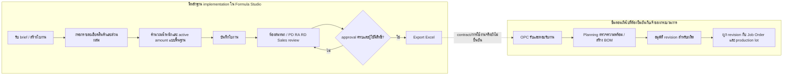
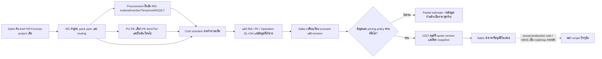

# เอกสารยืนยัน Workflow ธุรกิจ Beyond Formula และ Cost Calculator

วันที่จัดทำ: 2026-10-27  
สถานะ: **PARTIAL — มี workflow ของ Formula Studio ที่ยืนยันจาก source และมี workflow คำนวณต้นทุน/เสนอราคาที่บันทึกเป็นข้อยืนยันในเอกสารโครงการ; ส่วน Cost Calculator ยังไม่ใช่ระบบพร้อมใช้**  
วัตถุประสงค์: รวมหลักฐาน workflow ที่มีแล้วและชี้ข้อกำหนดที่ยังขาดก่อน implementation/UAT  
ขอบเขต: อ่าน source, เอกสาร architecture และเอกสารออกแบบใน `cost calculator by project/`; ไม่อ่านแฟ้ม local-only, secrets, customer/formula/cost payload หรือค่าราคาจริง; ไม่มีการแก้ระบบหรือทดสอบ runtime

ผู้รับผิดชอบการทำแผนที่ workflow รอบนี้: **Codex ตามคำสั่งล่าสุดของผู้ใช้**. การรวมข้อยืนยันที่บันทึกไว้ไม่เปลี่ยนอำนาจของ Procurement/RD/PU-PK/Finance/CEO ตามขอบเขตธุรกิจในเอกสาร และไม่เป็นการอนุมัติเปลี่ยนระบบหรือ release.

## สรุปสำหรับผู้ยืนยัน

หลักฐานในระบบปัจจุบันยืนยันได้ถึงการสร้าง/แก้ไขใบงาน การคำนวณส่วนผสมพื้นฐาน การทำงานร่วมกันในห้องสนทนา การอนุมัติ 4 บทบาท และการส่งออก Excel ตามสิทธิ์/approval ที่กำหนดในแอป ส่วนการรับงานจาก OPC, การสร้าง BOM, การปล่อยผลิต และการผูกสูตรกับ lot ยังไม่ยืนยันจากหลักฐานที่ตรวจ

ผมตรวจพบว่าคำถามธุรกิจหลายข้อมีคำตอบบันทึกไว้แล้วใน `cost calculator by project/SPEC.md` และ `REGISTRY.md`; จึงใช้คำยืนยันเหล่านั้นเป็น **DOCUMENTED_REVERIFY** แทนการถามซ้ำ อย่างไรก็ตามโฟลเดอร์ Cost Calculator ยัง untracked ใน parent repo, implementation plan ระบุ 0/27 delivery tasks complete และ audit เดิมยัง FAIL จึงต้องแยกข้อกำหนดที่บันทึกแล้วออกจากความสามารถที่ใช้งานจริง

หลักฐาน gateway วันที่ 2026-10-26 แสดงการเข้าใช้และบันทึกงาน/แชต/activity ผ่าน stack ที่มีป้าย `formula`; 4 เหตุการณ์ job-received มี status `saved`, และ gateway ไม่บันทึก write failure ในวันนั้น. นี่เป็นหลักฐานกิจกรรมจริงตาม log เฉพาะวันดังกล่าว ไม่ได้พิสูจน์ว่า approval ครบ, quotation ผ่าน CEO, หรือ runtime รุ่นใดกำลังทำงานในปัจจุบัน. รายละเอียด aggregate และข้อจำกัดอยู่ใน [รายงานตรวจระบบ](/Users/user/Developer/Beyond-formula/docs/AUDIT_2026-10-27.md).

## 1. แผนภาพ: ปัจจุบันเทียบกับสิ่งที่ต้องยืนยัน



## 2. ตาราง workflow สำหรับการยืนยัน

| ลำดับ | ขั้นตอนธุรกิจ (ร่างเพื่อยืนยัน) | หลักฐานปัจจุบัน | คำยืนยันที่ต้องการ | เจ้าของคำตอบ |
|---|---|---|---|---|
| 1 | รับคำขอและข้อมูลลูกค้า/ผลิตภัณฑ์ | มีฟอร์มและ local job ID; ไม่พบ OPC Job ID ใน model ที่ตรวจ | คำขอเริ่มใน Formula หรือ OPC? ใครเป็นผู้สร้างงานหลัก? ต้องมีข้อมูลใดครบก่อนเปิดงาน? | System Owner, Sales, OPC |
| 2 | กำหนดผู้รับผิดชอบ | พบ Sales owner และ role ในแอป | ใครเป็น owner ของงาน RD/PD/RA? เปลี่ยนผู้รับผิดชอบได้โดยใคร และต้องเก็บประวัติอย่างไร? | System Owner, RD/PD |
| 3 | พัฒนาสูตร | พบการแก้รายการส่วนผสมในใบงาน/แชต; ไม่พบ immutable formula revision | อะไรทำให้เกิด revision ใหม่? ต้องบันทึกเหตุผล/ผู้แก้/เวลา/ค่าก่อนหน้าใดบ้าง? | RD/PD, RA |
| 4 | ตรวจสอบสูตรและคำนวณ | พบ arithmetic น้ำหนัก × potency%; ไม่พบกฎ dosage-form conversion ที่อนุมัติ | หน่วยฐาน, serving/batch, active ingredient, overage/loss/yield, tolerance และ rounding ต่างกันตามรูปแบบสินค้าอย่างไร? | RD, QA/RA ตามบทบาทจริง |
| 5 | ทบทวนและอนุมัติ | แอปรองรับ approval PD, RA, RD, Sales เป็น gate ก่อน export; การแก้สูตรผ่านบางเส้นทางล้าง approval | แต่ละ approval ยืนยันเรื่องใด? ใครต้องอนุมัติทุกสูตร? มี approval เชิงพาณิชย์/คุณภาพ/กฎระเบียบแยกหรือไม่? | System Owner, RD, RA, Sales |
| 6 | ส่งออก/ส่งต่อ OPC | พบ Excel export; integration contract ระบุ handoff เป็น proposal | export เป็นทางส่งจริงหรือเพียงไฟล์ประกอบ? ใครยืนยันการรับ? สถานะ “ส่งแล้ว” จะเกิดเมื่อใด? | OPC, System Owner |
| 7 | ตรวจ production BOM และวางแผนผลิต | Cost Calculator SPEC กล่าวถึง packaging BOM จาก PU-PK; แต่ไม่พบหลักฐาน production BOM revision, RM code mapping หรือ Planning acceptance ในแอป | ยืนยัน production BOM owner, material code mapping, standard batch, substitution และ source of truth; แยกจาก packaging BOM ที่ PU-PK ดูแล | OPC, Planning, Procurement |
| 8 | ปล่อยผลิตและติดตาม lot | ไม่พบ formula revision ↔ Job Order ↔ production lot ใน model ที่ตรวจ | ใครมีอำนาจปล่อยผลิต? lot ต้องบันทึก snapshot ของสูตร/วัตถุดิบ/การอนุมัติอะไรเพื่อย้อนตรวจ? | Production, QA, System Owner |
| 9 | ปิดงาน/นำสูตรกลับมาใช้ | พบ optional close/reopen ในเอกสาร app; ไม่พบกฎ reuse/reorder แบบ canonical | ปิดงานหมายถึงอะไร? จะ clone/reorder สูตรเดิมอย่างไรโดยไม่แก้ประวัติสูตรที่ผลิตแล้ว? | RD/PD, System Owner |

**หลักฐานเพิ่ม 28 ต.ค. — รอ RD/RA และ System Owner ยืนยัน:** `integration/legacy-purity-parity.test.cjs` เปรียบเทียบฟังก์ชันจากสำเนาระบบเดิมสองชุดกับตัวอย่างมือถือโดยใช้สารสมมติ น้ำหนัก 100 และความเข้มข้น 0% ให้ผล 100 ในสำเนาระบบเดิม แต่ให้ผล 0 ในมือถือ; หากเว้นความเข้มข้น สำเนาเดิมให้ 100 และมือถือยังไม่คำนวณ สาเหตุที่ตรวจในสำเนาเดิมคือใช้ `parseFloat(value) || 100` ผลนี้ไม่ได้ยืนยันกฎธุรกิจ สถานะ อย. หรือรุ่นที่ deploy อยู่ และยังไม่ได้ตัดสินใจเปลี่ยนระบบใด

## 3. Workflow ต้นทุนและเสนอราคาที่บันทึกไว้ในเอกสารโครงการ

รายการต่อไปนี้ **มีสถานะยืนยันใน SPEC/REGISTRY ของ cost calculator** ตามคำตอบผู้ใช้ที่บันทึกไว้ แต่ยังเป็น design/plan ไม่ใช่ความสามารถ production ที่ยืนยันแล้ว:



| กฎ/เจ้าของที่บันทึกไว้ | สถานะหลักฐาน | ผลต่อ workflow |
|---|---|---|
| Formula project เป็นจุดอ้างอิง brief/identity; ไม่สร้าง customer/project master ซ้ำ | DOCUMENTED_REVERIFY (`SPEC.md:15`, `REGISTRY.md:5`) | รับ brief จาก project เดิม; mapping integration ยัง pending |
| RD เป็นเจ้าของ formula/material identity, pack requirements และ routing | DOCUMENTED_REVERIFY (`SPEC.md:16`, `REGISTRY.md:6,10`) | ต้องเก็บ revision และไม่ถือ calculator เป็นเจ้าของสูตร |
| Procurement ยืนยัน RM material/vendor/Tier/price/MOQ/LT ก่อนใช้ราคา; หนึ่ง Tier ต่อ material line ต่อ scenario | DOCUMENTED_REVERIFY (`SPEC.md:17`, cost project `AGENTS.md`) | ราคา/เงื่อนไขต้องเป็นชุดเดียวกันและยืนยันแล้ว |
| PU-PK เป็นเจ้าของการเลือก/เจรจา PK และผลคำนวณ versioned; calculator รับ snapshot ไม่สร้าง PK engine ซ้ำ | DOCUMENTED_REVERIFY (`SPEC.md:16`, `docs/adr/0001...`) | งาน RM/สูตรเดินต่อได้แม้ PK integration ยังขาด |
| ต้นทุนแยก RM, PK, Operation (DL/OH); consumption cost, procurement cash และ leftover exposure แยกกัน | DOCUMENTED_REVERIFY (`SPEC.md:23-31`) | ห้ามนับ MOQ เป็นวัสดุที่ใช้จริงซ้ำ หรือซ่อนส่วนที่ยังไม่รู้เป็นศูนย์ |
| ข้อมูลขาดต้องแสดง partial/pending; margin/markup ไม่ตั้งสมมติฐาน | DOCUMENTED_REVERIFY (`SPEC.md:18,29,39`; `AGENTS.md`) | คำนวณส่วนที่รู้ได้ แต่ยังเรียก final selling price ไม่ได้เมื่อ policy ขาด |
| Sales/OPC เห็นเฉพาะยอดหลังบวกที่เปิดเผยได้; ไม่เห็นต้นทุนก่อนบวก/ราคาผู้ขายตามสิทธิ์ที่ระบุ | DOCUMENTED_REVERIFY (`SPEC.md:7,38`; `REGISTRY.md:15,31-32`) | ต้องมี restricted projection/server-side authorization ก่อนเปิดใช้ |
| CEO อนุมัติและล็อก quotation version; แก้ไขต้องสร้าง revision และขออนุมัติใหม่ | DOCUMENTED_REVERIFY (`SPEC.md:20,39`; `REGISTRY.md:17`) | แยก commercial approval จาก technical release/approval ของ Formula |
| ขอบเขตโครงการจบที่ quote ที่ CEO อนุมัติและสรุปที่เปิดเผยได้ใน Formula project chat; WMS/actual cost/คิวผลิต/การส่ง quote อัตโนมัติอยู่นอก scope | DOCUMENTED_REVERIFY (`SPEC.md:9-11`) | workflow นี้ไม่ใช่ production handoff; ไม่ควรเชื่อม quote approval กับ release-to-manufacture โดยอัตโนมัติ |

**ความสามารถปัจจุบันของ Cost Calculator:** implementation plan ระบุ 0/27 delivery tasks complete, 1 TO_DO, 24 PLANNED, 2 BLOCKED; audit เดิมยัง FAIL. มีการทดลอง local-only แบบ synthetic 14 tests ซึ่งพิสูจน์เฉพาะ workflow model บางส่วน ไม่ใช่ PU-PK integration, formula/source validation, UAT หรือ production release (`TASK.md:3-8`; `docs/IMPLEMENTATION_PLAN.md:62-71,433-472`; `docs/PK_WORKFLOW_TRIAL.md:1-5,48-66`). ไม่ได้อ่านค่าราคา/สูตรจริงหรือแฟ้ม local-only.

## 4. สถานะที่ต้องนิยามร่วมกัน

รายการต่อไปนี้เป็นหัวข้อสำหรับตัดสินใจ ไม่ใช่ state ที่ระบบมีหรือได้รับอนุมัติแล้ว:

| ชื่อชั่วคราวเพื่อคุย | ความหมายที่ต้องตกลง | ผู้มีอำนาจยืนยัน |
|---|---|---|
| Draft / In Development | งานถูกสร้างแล้วแต่ยังแก้ข้อมูลได้; ต้องระบุเงื่อนไขพร้อมส่ง review | RD/PD, System Owner |
| In Review | ระบุผู้ตรวจและ approval ที่จำเป็นตามประเภทงาน | RD, RA, Sales และ System Owner |
| Approved for Export | ระบุให้ชัดว่าเป็นเพียงการยอมรับข้อมูลใน Formula Studioหรืออนุมัติคุณภาพ/กฎระเบียบด้วย | RD/RA/QA, System Owner |
| Submitted to OPC | จะใช้เมื่อสร้างคำขอส่งต่อ หรือเมื่อ OPC ตอบรับแล้ว? ต้องนิยาม acknowledgement | OPC, System Owner |
| Ready for Production / Released | ใครอนุมัติ, ใช้ revision ใด, มีเงื่อนไขเอกสาร/material readiness อะไร | Production, QA, OPC |
| Produced / Closed | ปิดเมื่อจบขั้นตอนไหน และผูกกับ lot/ผลผลิต/การเบี่ยงเบนอย่างไร | Production, QA, System Owner |

## 5. จุดที่ยังไม่มีข้อยุติในหลักฐานก่อน implementation

1. **Formula/OPC identifiers:** registry วาง ownership ของ central job ID ไว้ที่ Central Job Core แต่ mapping/coverage จริง, Formula ID/revision owner และ OPC handoff owner ยังเป็น pending.
2. **Formula calculation:** RD ต้องยืนยันกฎหน่วย/serving/batch, dosage form, tolerance, rounding, active basis, loss/yield/overage; ห้ามเอา UI arithmetic ไปแทน specification.
3. **Cost calculation inputs:** markup/margin, operation rates/allocation, loss/yield values, expense allocation, currency/tax/freight และ category pricing rules ยังมีส่วนที่ deferred/pending.
4. **PU-PK integration:** source formulas/status semantics, owner/contact, quote/snapshot mapping และ adapter ยัง blocked/unverified; synthetic trial ไม่ทดแทน source verification.
5. **Handoff boundary:** Formula chat summary กับ OPC handoff เป็นคนละ workflow; ยืนยันว่า production handoff ยัง out of scope ของ costing project ตาม SPEC หรือมีข้อกำหนดใหม่ที่อนุมัติแล้ว.
6. **Traceability:** ระบุ reference ระหว่าง formula revision, RM/PK source version, routing/rate version, cost scenario/revision, approval event, quote version และ (ถ้ามีในอนาคต) production batch.
7. **Access enforcement:** ออกแบบ role-filtered views ที่บังคับใช้ฝั่ง server; UI ซ่อนค่าลับอย่างเดียวไม่พอ.

## 6. เกณฑ์พร้อมยืนยันเป็น workflow ที่ตกลงแล้ว

ก่อนเรียก workflow นี้ว่าได้รับการยืนยัน ต้องมีผู้รับผิดชอบระบุ:

- ขั้นตอนและเงื่อนไขเข้า/ออกของแต่ละสถานะ
- เจ้าของข้อมูลและผู้รับผิดชอบในแต่ละขั้น
- รหัสเชื่อมโยงข้าม Formula, OPC, Job Order และ lot
- ความหมายและขอบเขตของ approval แต่ละประเภท
- ข้อกำหนดการคำนวณและผู้อนุมัติทางเทคนิค
- การตอบรับ/ปฏิเสธ/retry เมื่อส่งต่องานไม่สำเร็จ
- หลักฐานย้อนหลังที่ต้องเก็บและผู้มีสิทธิ์เห็น
- ผู้อนุมัติเอกสาร workflow และวันที่มีผล

## 7. หลักฐานและข้อจำกัด

- Formula Studio implementation: `index.html:769-835,2399-2429,2528-2555,4632-4638,4768-4772,5275-5310,5474-5484`.
- Current-state, ownership และ contract: `docs/architecture/CURRENT_STATE.md:91-141`; `docs/architecture/REGISTRY.md:5-58`; `docs/architecture/INTEGRATION_CONTRACTS.md:116-164,226-229`; `docs/architecture/GAP_ANALYSIS.md:15-112`.
- Costing/quotation design: `cost calculator by project/AGENTS.md`; `SPEC.md:3-59`; `REGISTRY.md:3-20`; `TASK.md:3-8`; `docs/IMPLEMENTATION_PLAN.md:62-71,433-472`; `docs/PK_WORKFLOW_TRIAL.md:1-5,48-66`. โฟลเดอร์ยัง untracked ใน parent repository และมีข้อกำหนดห้ามนำเข้า GitHub ซึ่งต้องรักษาตาม AGENTS.
- Runtime intake/historical status สรุปใน `docs/RECONCILE_2026-10-27.md`; เป็นหลักฐานตาม source/เอกสารที่ระบุ ไม่ได้ยืนยัน runtime ปัจจุบัน.
- ไม่อ่านแฟ้ม local-only, data rows, สูตร/ลูกค้า/ราคาจริง, `.env` หรือ database. อ่าน gateway log วันที่ 2026-10-26 แบบ aggregate โดยไม่เปิดเผยตัวระบุ/payload; ไม่เรียก endpoint และไม่ทดสอบ workflow กับระบบ.

## สถานะส่งมอบ

```yaml
status: PARTIAL — consolidated documented workflow; implementation/business gates remain open
task_id: not provided
issue_id: not provided
files_changed:
  - docs/WORKFLOW_CONFIRMATION_2026-10-27.md
tests_run: none
test_result: NOT RUN — read-only discovery
security_impact: none
database_impact: none
permission_impact: none
dependency_impact: none
rollback: remove this new draft document if requested
open_risks:
  - costing design folder is untracked and does not establish an approved GitHub baseline or working implementation
  - historic costing audit FAIL remains open; no costing source rows or live integration were read
  - Formula calculation, OPC handoff and production traceability rules remain incomplete/unverified
pr_reference: none
```
